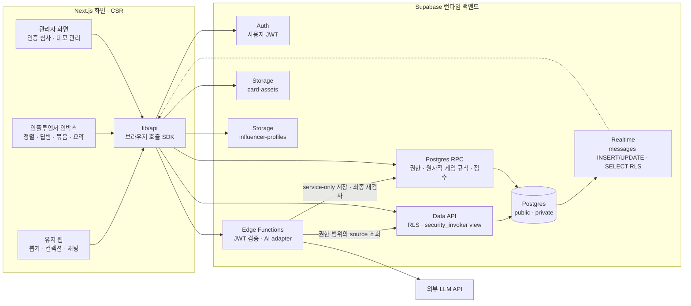

# BirdieBuddy — 전체 시스템 아키텍처

**최종 갱신:** 2026-11-10

> 제품 규칙은 [prd.md](./prd.md)를 기준으로 한다. 이 문서는 공통 아키텍처와 담당 경계를 설명하고, Supabase 백엔드의 상세 데이터·권한·SDK/RPC/Edge 계약과 구현 순서는 [홍주P_plan.md](./홍주P_plan.md)를 따른다.
>
> 이 구조는 **개발 착수 시 생성할 예정 구조**다. 현재 없는 supabase/·환경 파일·앱 코드를 문서 갱신 때문에 미리 만들지 않는다. 실제 구현·로컬 검증·실제 AI·팀 화면 통합·원격 배포 상태는 구분한다.
>
> 제품 요구사항과 다른 구현 기본값이 생기면 PRD와 담당 계획을 함께 갱신한다. 런타임에서는 CSR·RLS·Supabase 호출 계약을 따른다.

## 1. 전체 시스템과 데이터 흐름

유저 웹·인플루언서 인박스·관리자 화면은 하나의 Next.js 앱으로 제공한다. Next.js는 정적 UI shell과 CSR 화면을 맡고, 브라우저가 lib/api SDK를 통해 Supabase를 직접 호출한다. 실제 골프존 회원·라운드·결제 연동은 하지 않고 라운드 완료 버튼과 실제 Auth 데모 계정 전환으로 대체한다.



단순 조회는 Data API, 원자적 변경은 RPC, 비밀값·LLM 호출은 Edge Functions에서 처리한다. Next.js Server Actions·API Routes·Route Handlers나 별도 백엔드는 추가하지 않는다.

### 기술 스택

| 영역 | 선택 | 책임·기준 |
| --- | --- | --- |
| 화면 | Next.js App Router + TypeScript + Tailwind | 상태·사용자 데이터는 CSR, 서버 컴포넌트는 정적 shell |
| 호출 계층 | Supabase JS + lib/api | 도메인 타입·오류·페이지·RPC/Function 호출·구독 helper |
| 인증 | Supabase Auth | profiles.id=auth.users.id, 가입 시 user, 권한 변경은 관리 경계 |
| DB | Supabase Postgres + migrations | 모든 공개 테이블 RLS, 명시적 grants, 조회 view는 security_invoker |
| AI | Edge Functions + _shared AI adapter | 문환P 모델 로직, 홍주P 인증·전송·저장·실패 처리 |
| 실시간 | Realtime Postgres Changes | messages INSERT/UPDATE, SELECT RLS 범위. 연결 장애 시 3초 폴링 |
| 이미지 | Supabase Storage card-assets / influencer-profiles | 카드 10명×3스타일=30개. 카드 이미지는 공개 읽기·관리자 쓰기, 프로필 사진은 공개 읽기·인증된 본인 인플루언서의 WebP 업로드 전용. 교체 시 새 객체 경로 사용 |
| 실행·검증 | Node.js 24, Deno 2, Supabase CLI, Docker 호환 런타임 | Node/SDK와 Deno/Edge 검사 분리 |
| 배포 | Supabase CLI + Vercel | DB/Functions는 Supabase, 프론트는 Vercel |
| 키 | 브라우저 publishable key + 사용자 JWT | 관리·LLM·Supabase secret key는 브라우저에 노출하지 않음 |

## 2. 레포 구조와 담당 경계

프론트 화면·컴포넌트 담당은 유지한다. 홍주P 구현 위치는 lib/supabase·lib/api·supabase·scripts·tests로 정리한다.

```text
BirdieBuddy/
├─ docs/
│  ├─ architecture.md                  # 팀 공통 구조·담당 경계
│  └─ *_plan.md                        # 담당자별 실행 계획
├─ app/                                # CSR 화면·라우팅
│  ├─ (user)/
│  │  ├─ draw/                         # 뽑기 연출·결과 — 현호P
│  │  ├─ collection/                   # 컬렉션·강화 — 현호P
│  │  │  ├─ owned/                     # 보유 카드 — 현호P (P1), /collection/owned
│  │  │  └─ upgrade/                   # 보유 카드 강화 — 현호P (P1), /collection/upgrade
│  │  └─ chat/                         # 방 목록·입장·대화 — 자성P
│  ├─ inbox/                           # 인플루언서 인박스 — 자성P
│  └─ admin/                           # 인증 심사·관리 화면 — 자성P
├─ components/
│  ├─ card/                            # 카드·카드팩·등급 효과 — 현호P
│  ├─ chat/                            # 메시지·게이지·배지 — 자성P
│  │  └─ use-room-messages.ts          # SDK 구독 helper 연결 — 자성P
│  └─ ui/                              # 공통 UI — 자성P 셋업·현호P 디자인
├─ lib/
│  ├─ supabase/                        # 홍주P
│  │  ├─ client.ts                     # 브라우저 클라이언트
│  │  └─ database.types.ts             # CLI 생성 DB 타입
│  └─ api/                             # 홍주P: Supabase 호출 SDK
│     ├─ index.ts                      # createBackendApi(client)·브라우저 export
│     ├─ types.ts                      # 도메인 타입·Result·ApiError·Page
│     ├─ cards.ts                      # 뽑기·컬렉션·강화
│     ├─ rooms.ts                      # 목록·입장·멤버십·월 라운드 요약·데모 월 경과
│     ├─ chat.ts                       # 팬/인플루언서 메시지·재연결 복구·인박스·답변·방별 차단 집계·AI 기능
│     ├─ verifications.ts              # 신청·목록·관리자 심사
│     ├─ game-config.ts                # 설정 읽기·관리자 변경
│     ├─ room-filters.ts               # 방 필터 읽기·변경
│     └─ influencer-profiles.ts        # 인플루언서 프로필 사진 업로드·조회
├─ supabase/                           # 홍주P: 개발 착수 시 init
│  ├─ config.toml                      # 로컬 구성·Function 설정
│  ├─ migrations/                      # schema·RLS·grants·RPC·trigger·Storage·publication
│  ├─ seed.sql                         # 비기밀 콘텐츠·게임 설정 기본값
│  ├─ tests/                           # DB·RLS·RPC 테스트 — 홍주P
│  └─ functions/
│     ├─ .env.example                  # 비밀 없는 Function 환경 예제
│     ├─ _shared/                      # 공통 인증·검증·AI adapter
│     │  └─ ai.ts                      # 문환P AI 로직 ↔ 홍주P adapter 경계
│     ├─ submit-message/index.ts       # 홍주P: 인증·판정·최종 저장
│     ├─ send-influencer-message/index.ts # 홍주P: 답변·전체 메시지 mandatory filter
│     ├─ update-room-greeting/index.ts # 홍주P: 인사말 필터·설정
│     ├─ summarize-room/index.ts       # 홍주P 전송 계층 + 문환P 요약
│     └─ cluster-questions/index.ts    # 홍주P 전송 계층 + 문환P 질문 묶기
├─ scripts/                            # 홍주P: Node 실행·검증 도구
│  ├─ prepare-local-env.mjs            # local:start/local:env, 비밀값 비출력
│  ├─ setup-demo-accounts.mjs          # 로컬 Auth Admin + pg 프로비저닝
│  └─ verify-backend.mjs               # P0/P1/P2·역할·Realtime 스모크
├─ tests/backend/                      # 홍주P: SDK·Edge 경계·동시성 검증
├─ package.json                        # B-01이 backend 바탕을 생성, F-01이 Next.js 의존성·scripts를 추가
├─ tsconfig.backend.json               # Node/SDK 검사, Edge는 Deno로 별도 검사
└─ .env.example                        # 비밀 없는 프론트 연결 예제, 착수 시 생성
```

### 변경된 경로의 의미

| 과거 위치 | 현재 위치·책임 |
| --- | --- |
| app/api/ | 생성하지 않음. Data API·RPC·Edge Function을 lib/api에서 호출 |
| lib/db/ | lib/supabase/client.ts·database.types.ts와 lib/api 도메인 모듈로 분리 |
| lib/ai/ | supabase/functions/_shared/ai.ts. 실제 AI 로직은 문환P, adapter·호출 검증은 홍주P |
| lib/scoring.ts | supabase/migrations/의 점수 SQL helper·저장 RPC |
| lib/config.ts | lib/api/game-config.ts. 값 검증·변경 권한은 DB RPC |
| supabase/schema.sql | 순서가 있는 supabase/migrations/*.sql로 관리 |
| SQL seed의 Auth 계정·암호 | seed는 콘텐츠만, 계정은 scripts/setup-demo-accounts.mjs |

lib/api는 브라우저 SDK이며 서버 구현 위치가 아니다. 클라이언트에는 표시용 타입과 호출·오류 정규화를 두고, 권한·보유량·점수·게임 규칙은 DB/Edge에서 판단한다. SQL 원문은 migration만 실행 기준으로 관리하고 이 문서에 중복하지 않는다.

### 공통 개발 규칙

1. 상태가 있는 화면은 client component로 만들고 데이터 호출은 lib/api를 사용한다. Auth·Storage처럼 직접 사용하는 Supabase 서비스도 같은 세션·키 원칙을 따른다.
2. createBackendApi(client)로 호출 클라이언트를 주입한다. 브라우저 export와 Node 테스트는 같은 도메인 로직을 사용하고 import 시 window/localStorage에 접근하지 않는다.
3. 모든 mutation은 requestId를 사용한다. 네트워크 재전송은 같은 ID, 새 사용자 동작은 새 ID다. 반환 타입은 Result<T>, 상세 오류 코드는 홍주P 계획 §6을 따른다.
4. actor는 검증한 세션에서 얻는다. 브라우저 userId·role·quality·verdict·보유량을 신뢰하지 않는다. messages의 bigint ID는 전송 전 문자열로 보존한다.
5. 문서 구조는 예정 산출물이다. 개발 시작 요청 전에는 삭제한 supabase/·.env.example을 재생성하거나 원격 변경을 하지 않는다.

## 3. 데이터 모델과 권한

아래는 핵심 public 12개 테이블의 역할 요약이다. 컬럼·제약·인덱스·RLS·함수 권한의 상세는 홍주P 계획 §4를 따른다.

| 테이블 | 핵심 역할·변경 사항 |
| --- | --- |
| profiles | Auth 사용자 ID와 동일한 프로필·role. 독립 users ID를 만들지 않음 |
| influencers | 공개 표시명·유형·verified_at·profile_image_path. 계정 매핑은 private |
| card_templates | 인물×스타일 30개, image_path 저장. SDK가 환경별 공개 URL 생성 |
| user_cards | 사용자·template·grade별 장수. 본인 읽기, 추첨·강화 RPC만 변경 |
| rounds | 라운드 시각·활동 월·real/demo 구분. 월 마감 집계 기준 |
| draws | 라운드당 추첨 1회, 등급·template·is_new·forced 이력 |
| chat_rooms | 인증된 인물당 1개 방. 기본10개, 11번째 신청 승인 시 카드 템플릿 없는 방 추가. 필터·인사말 설정은 private |
| room_members | gauge(소수점 1자리)·active/left·최신 입장 월·퇴장 효력 월. 입장·월 마감 RPC 변경 |
| messages | 팬 질문·influencer 답변/전체 메시지/첫 입장 인사말. 입장 기간과 수신자에 따른 RLS, 문자열 ID, 안전한 reply context, priority snapshot, soft delete와 updated_at 변경 cursor |
| message_clusters | 같은 방의 미답변 질문 묶음·대표문장. 활성 고유 질문자 수는 조회 시 계산 |
| verifications | 본인 인증 신청·관리자 심사 상태 |
| game_config | 검증 가능한 게임 설정·version. 인증 사용자 읽기·관리자 RPC 변경 |

비공개 보조 모델은 private schema의 influencer_accounts, demo_accounts, demo_clock, demo_month_runs, room_settings, room_member_periods, moderation_suggestions, operations, moderation_events, verification_reviews, rate_windows, demo_fixture_runs다. Data API 노출 schema에 포함하지 않는다. 공개 테이블 12개가 전체 DB 테이블 수의 상한이라는 뜻은 아니다.

권한의 공통 기준:

- 모든 public 테이블에 RLS와 명시적 grants. security_invoker view는 기초 테이블의 RLS를 유지한다.
- anon은 DB 데이터·RPC 접근 없이 공개 카드·프로필 이미지 읽기만 가능하다. 가입은 항상 user이며 역할·데모 capability는 서버 관리 경계에서만 부여한다.
- user는 본인 카드·라운드와 자기 질문, 본인의 입장 구간에 게시된 influencer 답변/전체 메시지/인사말만 읽는다. 입장 전·퇴장 기간 메시지는 숨기고 퇴장 중에는 방을 열 수 없다. 재입장 시 과거 입장 구간 대화는 복구하며, 퇴장 기간에 달린 본인 질문의 답변은 예외로 읽는다. greeting은 수신자 본인만 읽는다. 다른 팬 질문 행은 Data API와 Realtime에서 모두 숨긴다. influencer는 본인 인증 신청과 매핑된 본인 방의 전체 대화·인박스·필터·인사말 설정·AI 기능을 사용한다. admin은 인증 심사·설정·카드 자산·허용된 데모를 관리한다. admin이라는 이유로 타인 카드·대화·인박스를 읽거나 influencer 명의로 답변하지 못한다.
- submit_moderated_message·submit_influencer_message 등 내부 저장 RPC는 Edge의 service-only 호출만 허용한다. 인증·멤버십 기간·필터 version은 최종 저장 시 DB에서 재검사하고 점수를 계산한다.
- messages에는 block/suggest 원문을 저장하지 않는다. private moderation_events에는 판정 metadata만 7일 보관하며 rewrite·원문·JWT·키를 DB 감사 기록이나 로그에 복사하지 않는다.
- Realtime에는 messages INSERT와 influencer 답변/전체 메시지의 삭제 UPDATE를 전달한다. 방 필터 조건이 아니라 SELECT RLS가 이벤트 권한 경계다. 팬은 본인 질문과 현재 수신 자격이 있는 influencer 메시지만 받고 방 주인은 방 전체를 받는다. SDK는 updated_at,id cursor로 reconnect 뒤 오래된 행의 soft delete도 복구한다. 로그아웃·퇴장·계정/방 변경 시 구독·캐시·폴링을 정리한다.
- influencer 답변은 원 질문의 passesAllFilters가 참일 때만 원문을 닉네임 없이 reply context로 보존한다. 거짓이면 reply_to 관계만 유지하고 팬 화면은 본인의 질문 행을 사용한다. 묶음 답변은 모든 필터를 통과한 대표 질문을 전달하며 “내 질문에 대한 답변” 표시는 질문자 본인 화면에만 붙인다.
- 답변·전체 메시지를 삭제하면 body를 null로 지우고 삭제 시각을 기록한다. 팬 화면에는 "삭제된 메시지"를 보이며 답변 삭제는 해당 질문 또는 묶음을 다시 미답변으로 연다. 팬 질문·인사말은 삭제할 수 없다.

### 게임 설정과 규칙 요약

등급은 common→rare→epic→special, 스타일은 illust/retro/holo, 유형은 youtuber/media_pro/tour다. 카드 라인업은 가상 인물10명(투어5·유튜버3·미디어 프로2)이며 30 template을 만든다. 별도의 11번째 심사 대기 인물은 카드 template과 방 없이 신청한다.

| game_config key | 초기 기본값 |
| --- | --- |
| grade_rates | common70·rare20·epic7.5·special2.5 (%) |
| upgrade_cost | 같은 template·grade 10장→다음 grade 1장 |
| room_entry | 해당 인물 라운드 보상 누적 발급 5장, 등급·스타일 무관·카드 미소모 |
| priority_weights | 보유 배지 기반 ownScore 0.6 + qualityScore 0.4 |
| own_score | Buddy30·Eagle60·Albatross90, 보유 스타일 추가 1종당 +5(최대+10), 배지 없어도 스타일 가산. 점수 규칙은 홍주P 계획 §5.5 |
| gauge | 입장·재입장 시50, 월 기준3회에서 라운드 1회당 ±12.5, 최대100, 0이면 퇴장 |

확률·비용·입장 수·게이지 수치는 PRD 시연 기본값이다. 라운드 완료로 지급된 draws는 강화 뒤에도 누적 입장 자격과 배지 집계에 남는다. 보유 배지는 Buddy(누적10장 또는 Epic 이상), Eagle(누적15장 또는 Special), Albatross(누적15장 그리고 Special)이며 가장 높은 조건을 적용한다. badge base 점수는 없음0/Buddy30/Eagle60/Albatross90이고, 보유 스타일 2종은 +5, 3종은 +10으로 배지와 무관하게 적용한다. qualityScore는 검증한 AI 결과다. 질문 저장 시 ownScore와 priority를 snapshot으로 보존하며 priority 동점은 최근 메시지를 먼저 둔다.

추첨은 등급을 먼저 뽑고 30개 template 중 균등 추첨한다. `isNew`는 추첨 직전 해당 template을 등급 무관하게 현재 0장 보유했는지다. 시연용 `demoForceGrade`는 capability가 있는 계정의 `completeRound` 입력으로만 허용하고 draws.forced로 기록한다. 강제 발급도 누적 획득·입장·배지 계산에는 포함하고 확률 검증에서는 제외한다. 카드 지급은 DB에서 애니메이션보다 먼저 확정되므로 화면을 나가도 보유 기록은 유지된다. 프로토타입의 `requestId`는 전송 재시도만 막는다. 같은 실제 골프존 라운드의 중복 발급 방지와 미개봉 카드팩은 실서비스 연동 과제다.

월 라운드 수는 모든 채팅방에서 공통으로 인정한다. 게이지는 기준 3회에서 초과·부족 각 1회당12.5를 더하거나 빼고 0~100으로 제한한다. 입장·재입장한 달은 오르거나 내리지 않고 월 정산 전체를 건너뛴다. 퇴장한 사용자가 한 달력 월에 라운드 3회를 완료하면 그 달에 left인 방 모두 재입장할 수 있고 gauge는 50으로 재시작한다. 휴면·활동 랭킹 정책은 후속 실서비스 범위라 프로토타입 월 정산에는 적용하지 않는다. 데모 월 마감은 논리 월을 사용하고 실제 일반 사용자 월 자동화와 구분한다. 자세한 계산·잠금·점수 공식은 홍주P 계획 §§5·7을 따른다.

## 4. 화면이 사용하는 서비스 계약

팀의 접점은 아래 SDK 함수·Supabase 서비스·도메인 타입이다. 별도의 서버 REST 경로를 다시 만들지 않는다. 입력/응답·오류·페이지·멱등성은 홍주P 계획 §§6~8이 상세 기준이다.

| 화면 SDK·호출 | Supabase 구현 | 담당 티켓 | 소비자 |
| --- | --- | --- | --- |
| 로그인·데모 세션 전환 | Auth 로그인/로그아웃 | B-01·B-02 기반 | 전원 |
| completeRound | complete_round RPC; 누적 입장 기준을 넘는 발급에 `entryUnlocked: true` 반환 | B-03 | 현호P |
| getCollection / getOwnedCards / upgradeCard | collection_view / inventory_view / upgrade_card RPC | B-04 | 현호P |
| getRooms / getMyMembership / joinRoom | room_catalog / room_members / join_room RPC; 누적 발급 5장, 퇴장 후 월 3회 재입장, 템플릿 미준비는 카드 준비 중 | B-05 | 자성P |
| getMyRoundGaugeSummary | get_my_round_gauge_summary RPC; 현재 월·전체 월 라운드 수·목표·남은 라운드 | B-07 | 자성P 게임 시작·방 입장 |
| getMessages / getMessageChanges / subscribeRoomMessages | messages Data API / Realtime; 팬별 본인 질문과 입장 기간의 답변·전체 메시지·첫 인사말, deleted update cursor. Status: SUBSCRIBED/TIMED_OUT/CHANNEL_ERROR/CLOSED | B-06 | 자성P |
| reconcileRoomMessages | SDK가 getMessageChanges 페이지를 모두 읽어 ID 기준 upsert와 cursor 복구 결과 반환 | B-06 | 자성P use-room-messages.ts |
| submitMessage | submit-message Edge → service-only 저장 RPC; passesAllFilters와 10분 1회 제안 token 반환 | B-06 + 문환P A-02·A-03 | 자성P |
| advanceDemoMonth | advance_demo_month RPC | B-07 | 자성P 데모 관리 |
| getRoomInbox / replyToMessage | get_room_inbox RPC / send-influencer-message Edge; 답변은 필수 차단 필터 적용 | B-08 | 자성P |
| sendBroadcast / deleteInfluencerMessage | send-influencer-message Edge / delete_influencer_message RPC; active 팬 수신·삭제 UPDATE | B-16·B-17 | 자성P |
| getRoomGreeting / updateRoomGreeting | get_room_greeting RPC / update-room-greeting Edge; 200자·필수 필터·최초 입장 snapshot | B-15 | 자성P |
| getRoomDailyBlockCount | get_room_daily_block_count RPC; 비공개 moderation_events에서 KST 오늘의 방별 block request 수만 집계 | B-06·B-08 | 자성P 인박스 설정 |
| requestVerification / getMyVerifications | request_verification RPC / verifications | B-09 | 자성P |
| getPendingVerifications / approveVerification | verifications / approve_verification RPC; 11번째 승인 시 방 생성 | B-09 | 자성P 관리자 화면 |
| getMyInfluencerProfile / uploadInfluencerProfilePhoto | 본인 전용 get_my_influencer_profile RPC / influencer-profiles Storage + set_influencer_profile_photo RPC | B-14 | 자성P 인박스 설정 |
| getRoomFilters / updateRoomFilters | get_room_filters / update_room_filters RPC | B-10 | 자성P |
| getGameConfig / updateGameConfig | game_config / update_game_config RPC | B-03·B-10 | 현호P·자성P, 변경은 관리자 |
| summarizeRoom / clusterQuestions | summarize-room / cluster-questions Edge; 미답변 질문만 묶고 답변 시 묶음 폐쇄 | B-12 + 문환P 요약·묶기 | 자성P |

B-11은 환경·관리 연결·배포·복구 절차, B-13은 역할별·동시성·SDK/Edge 통합 검증을 맡는다. 단순 조회 권한과 변경 권한을 같은 것으로 취급하지 않는다.

### 루트 bootstrap과 F-01 순서

B-01은 첫 단계에서 `package.json`·`package-lock.json`, backend toolchain·scripts, `lib/`·`supabase/` 뼈대만 준비해 `main`에 올린다. 범위는 backend 의존성과 공통 검사 설정, 빈 폴더 구조와 Supabase 로컬 config까지다. migrations·schema·Auth·RLS·기능 SDK는 이 bootstrap에 포함하지 않는다. F-01은 그 manifest에 Next.js·Tailwind 의존성과 화면 scripts를 추가해 `app/`·레이아웃·라우트를 만든다. B-01의 schema/Auth/RLS 작업은 F-01 이후 계속 진행하며 F-01의 선행조건으로 삼지 않는다. 루트 파일은 이 순서로 한 번에 하나의 작업이 편집한다.

프로필 이미지 업로드는 JPG/PNG/WebP 입력을 WebP로 변환해 요청별 새 Storage 객체로 저장한다. `profile_image_path`만 현재 포인터로 바꾸며 메시지에 사진을 복제하지 않아 기존 답변·전체 메시지·인사말 말풍선에도 변경이 반영된다. `getMyInfluencerProfile`은 ID 입력 없이 `auth.uid()`로 본인 정보를 읽는다. `RoomCatalogItem.profileImageUrl`은 프로필 사진이 있으면 그 URL, 없으면 illust 카드 URL을 반환하고 둘 다 없으면 null이라 화면이 이름 첫 글자를 쓴다.

## 5. AI 구현 경계

문환P는 supabase/functions/_shared/ai.ts에서 사용하는 AiAdapter의 실제 LLM 로직·프롬프트·품질·금칙어 fallback을 제공한다. 홍주P는 인증·입출력 검증·호출 제한·lease·멱등성·최종 저장 RPC·실패 응답을 구현한다.

| adapter 함수 | 역할 | 홍주P 검증·저장 경계 |
| --- | --- | --- |
| moderateAndScore | 본문·disabledFilters → pass/suggest/block·category·rewrite·quality·rewriteQuality·passesAllFilters | JWT·active·필터 version 재검사. pass만 저장하고 모든 필터 통과 여부로 질문 인용을 제한 |
| clusterQuestions | 허용된 같은 방 질문 ID/본문 → 대표문장·ID 묶음 | source·중복·미답변 재확인, 같은 방 트랜잭션 반영 |
| summarize | 허용된 같은 방 대화 → 요약문 | 소유권·입력/출력 길이·source 검증 |

AiAdapter 타입의 유일한 상세 기준은 홍주P 계획 §8.1이다. 여기서 다른 함수 시그니처를 중복 정의하지 않는다. ownScore·priority는 AI 모듈이 아니라 DB helper/저장 RPC에서 계산한다.

개발자가 주입하는 로컬 fixture는 전송·권한·응답 형식 검증에만 쓴다. Jev/AI 키 누락 또는 공급자 timeout·5xx는 문환P adapter의 keyword fallback으로 처리한다. fallback을 통과한 질문은 quality=50으로 저장하고, fallback 차단은 위반 횟수에 넣지 않는다. 이는 실제 LLM 성공으로 보고하지 않는다. Adapter 예외·응답 형식 불량·점수 오류는 FILTER_UNAVAILABLE이며 저장하지 않는다. 답변·전체 메시지·인사말은 선택 필터 설정을 적용하지 않고 필수 차단 7개(threat, stalking, sexual_harassment, privacy, hate, illegal_ad, spam)를 적용한다. 상세 token·멱등성·저장 규칙은 홍주P 계획 §§7~8을 따른다.

## 6. 초기화·환경·배포

연결 대상과 공개 값은 홍주P 계획 §2에만 기록한다. 이 문서에 키를 중복하지 않는다. publishable key는 사용자 작업용이며 테이블·함수 변경 권한이 아니다.

개발 착수 흐름은 다음과 같다.

1. 기존 package/수정사항 보존 → 고정 CLI·SDK·Node/Deno 검사 도구 준비.
2. config가 없으면 supabase init → migration·seed·Function·SDK·scripts·예제 env 작성.
3. local:start로 로컬 stack 시작과 연결 값 수집 → 실제 로컬 env 생성. 원격 로그인·원격 키를 선행 조건으로 요구하지 않음.
4. 로컬 reset → 실제 DB 타입 생성 → Auth Admin+pg로 데모 계정·private 데이터 준비 → 정적·DB·Edge·SDK·Realtime 검증.
5. 명시적인 원격 적용 요청·대상 환경·관리 권한이 있으면 별도로 이력·dry-run·migration·Functions·Secrets·원격 스모크 수행.

브라우저 .env.local, Node .env.backend.local, Functions .env를 구분한다. 브라우저/Node는 호스트의 로컬 URL, Edge는 플랫폼 SUPABASE_URL을 사용한다. 관리자 키·DB URL·암호·JWT는 브라우저와 Git·로그에서 제외한다. 로컬 init이나 config 변경이 원격에 자동 적용된다고 보지 않는다.

Node 스크립트는 로컬 준비·테스트 도구이며 새로운 런타임 서버가 아니다. 배포는 DB/Functions를 Supabase CLI로, 프론트를 Vercel로 수행한다. 원격 reset이나 적용 migration 수정으로 이력을 맞추지 않는다. 상세 명령·복구·외부 조건은 홍주P 계획 §§2·9~10·13을 따른다.

## 7. 역할과 팀 연결 지점

| 담당 | 역할 | 주요 산출물·책임 | 티켓 | 계획 |
| --- | --- | --- | --- | --- |
| 자성P | 채팅 중심 프론트 | 프로젝트 셋업·방/채팅·인박스·관리자 화면·SDK 구독 연결 | F-01~F-16 | [자성P_plan.md](./자성P_plan.md) |
| 홍주P | Supabase 백엔드·SDK | schema/RLS/RPC·시드·채팅/게임/인증·인사말·전체 메시지·삭제·프로필 사진·Edge 전송 계층·검증·배포 절차 | B-01~B-17 | [홍주P_plan.md](./홍주P_plan.md) |
| 문환P | AI 활용 | 의사결정 모델(jev)·필터/품질·묶기/요약·금칙어 fallback·테스트 세트·카드 발급 함수 | A-01~A-05, A-07~A-09 | [문환P_plan.md](./문환P_plan.md) |
| 현호P | 카드 UI·디자인 | 뽑기/컬렉션/강화·전체 디자인·프레임·배지·카드 이미지 생성 | D-01~D-11, A-06 | [현호P_plan.md](./현호P_plan.md) |
| 미정 | 시연·발표 | 대본·발표 자료 | U-01 | [anonymous-plan.md](./anonymous-plan.md) |

- 카드: 홍주P cards SDK → 현호P 연출·컬렉션 화면.
- 채팅: 홍주P rooms/chat SDK·구독 helper → 자성P 화면·use-room-messages.ts.
- AI: 문환P 실제 adapter → 홍주P JWT 인증 Edge Function → service-only 저장 RPC.
- 이미지: 현호P 아트 디렉션(D-02)·생성(A-06) → 홍주P card-assets/seed 연결(B-02).
- 설정·인증: 홍주P 권한 검증 RPC/SDK → 자성P 관리자 화면.

실제 AI·이미지·화면을 기다리는 동안에는 홍주P 계획 §3의 가상 인물·placeholder·fixture·SDK 테스트를 사용한다. 백엔드 코드·로컬 완료와 팀 전체 데모 완료를 구분한다.

## 8. 우선순위와 공통 체크포인트

| 티어 | 범위 | 목표 |
| --- | --- | --- |
| P0 | 라운드 완료·카드 지급/뽑기·컬렉션·별도 강화 화면과 기본 강화 연출, 환경·검증 기반 | 1일차 저녁 T-03 |
| P1 | 채팅방 입장·메시지 안전 필터/안내·우선순위 인박스·답변·게이지 및 월 잔여 라운드/소진 경고, 강화 등급별 연출/건너뛰기, 별도 보유 카드 화면 | 2일차 점심 T-04 |
| P2 | PRD 순서대로 인증 → 유사 질문 묶기 → 대화 요약 → 선택 필터 설정 → 인사말 → 전체 메시지 → 답변/전체 메시지 삭제 → 프로필 사진(마지막) | 2일차 기능 동결 전 |

P0/P1/P2는 순서이며 전체 구현 요청에서 P2를 자동 제외하는 기준이 아니다.

- [ ] **T-01** SDK 함수·RPC·Edge 이름과 타입·오류·구독 계약 확인. 서버 경로 목록을 새로 만들지 않음.
- [ ] **T-02** 가상 인물10명과 30개 카드 자산·AI 공급자 확인. 실존 인물 대신 가상 이미지로 독립 개발하고, 11번째 대기 신청자는 카드 없이 둔다.
- [ ] **T-03** P0 SDK 로컬 통합 후 담당 화면·배포 URL 통합을 별도 확인.
- [ ] **T-04** 입장 → pass/suggest/block → Realtime → 인박스/답변·게이지 흐름 확인.
- [ ] **T-05** 기능 동결 후 전체 시연 리허설 2회.

U-01 시연 대본·발표 자료는 담당 미정으로 유지한다. 검증 증거는 환경·명령·역할·결과·미검증 범위와 함께 기록한다. 이 문서를 갱신했다고 코드·DB·실제 AI·원격 배포가 완료된 것으로 표시하지 않는다.
