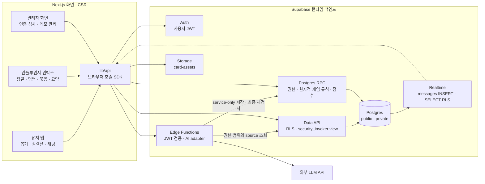

# BirdieBuddy — 전체 시스템 아키텍처

**최종 갱신:** 2026-11-10

> 팀 공통 구조와 담당 경계를 설명한다. Supabase 백엔드의 상세 데이터·권한·SDK/RPC/Edge 계약과 구현 순서는 [홍주P_plan.md](./홍주P_plan.md)를 기준으로 한다.
>
> 이 구조는 **개발 착수 시 생성할 예정 구조**다. 현재 없는 supabase/·환경 파일·앱 코드를 문서 갱신 때문에 미리 만들지 않는다. 실제 구현·로컬 검증·실제 AI·팀 화면 통합·원격 배포 상태는 구분한다.
>
> 기획 참고: [BirdieBuddy 해커톤 개발 설계 & 역할 분담](https://claude.ai/artifact/HQ7wLf6Cewh2thGTH37Dof). 원문 확인 여부와 보완 기본값은 홍주P 계획에 명시되어 있다. 다른 담당자 계획에 남은 과거 서버 경로는 아래 CSR 호출 계약과 맞춰 연결한다.

## 1. 전체 시스템과 데이터 흐름

유저 웹·인플루언서 인박스·관리자 화면은 하나의 Next.js 앱으로 제공한다. Next.js는 정적 UI shell과 CSR 화면을 맡고, 브라우저가 lib/api SDK를 통해 Supabase를 직접 호출한다. 실제 골프존 회원·라운드·결제 연동은 하지 않고 라운드 완료 버튼과 실제 Auth 데모 계정 전환으로 대체한다.



단순 조회는 Data API, 원자적 변경은 RPC, 비밀값·LLM 호출은 Edge Functions에서 처리한다. Next.js Server Actions·API Routes·Route Handlers나 별도 백엔드는 추가하지 않는다.

### 기술 스택

| 영역 | 선택 | 책임·기준 |
| --- | --- | --- |
| 화면 | Next.js App Router + TypeScript + Tailwind | 상태·사용자 데이터는 CSR, 서버 컴포넌트는 정적 shell |
| 호출 계층 | Supabase JS + lib/api | 도메인 타입·오류·페이지·RPC/Function 호출·구독 helper |
| 인증 | Supabase Auth | profiles.id=auth.users.id, 가입 시 user, 권한 변경은 관리 경계 |
| DB | Supabase Postgres + migrations | 모든 공개 테이블 RLS, 명시적 grants, 조회 view는 security_invoker |
| AI | Edge Functions + _shared AI adapter | 문환P 모델 로직, 홍주P 인증·전송·저장·실패 처리 |
| 실시간 | Realtime Postgres Changes | messages INSERT만, SELECT RLS 범위. 연결 장애 시 3초 폴링 |
| 이미지 | Supabase Storage card-assets | 10명×3스타일=30개, 공개 읽기·관리자 쓰기 |
| 실행·검증 | Node.js 24, Deno 2, Supabase CLI, Docker 호환 런타임 | Node/SDK와 Deno/Edge 검사 분리 |
| 배포 | Supabase CLI + Vercel | DB/Functions는 Supabase, 프론트는 Vercel |
| 키 | 브라우저 publishable key + 사용자 JWT | 관리·LLM·Supabase secret key는 브라우저에 노출하지 않음 |

## 2. 레포 구조와 담당 경계

프론트 화면·컴포넌트 담당은 유지한다. 홍주P 구현 위치는 lib/supabase·lib/api·supabase·scripts·tests로 정리한다.

```text
BirdieBuddy/
├─ docs/
│  ├─ architecture.md                  # 팀 공통 구조·담당 경계
│  └─ *_plan.md                        # 담당자별 실행 계획
├─ app/                                # CSR 화면·라우팅
│  ├─ (user)/
│  │  ├─ draw/                         # 뽑기 연출·결과 — 현호P
│  │  ├─ collection/                   # 컬렉션·강화 — 현호P
│  │  └─ chat/                         # 방 목록·입장·대화 — 자성P
│  ├─ inbox/                           # 인플루언서 인박스 — 자성P
│  └─ admin/                           # 인증 심사·관리 화면 — 자성P
├─ components/
│  ├─ card/                            # 카드·카드팩·등급 효과 — 현호P
│  ├─ chat/                            # 메시지·게이지·배지 — 자성P
│  │  └─ use-room-messages.ts          # SDK 구독 helper 연결 — 자성P
│  └─ ui/                              # 공통 UI — 자성P 셋업·현호P 디자인
├─ lib/
│  ├─ supabase/                        # 홍주P
│  │  ├─ client.ts                     # 브라우저 클라이언트
│  │  └─ database.types.ts             # CLI 생성 DB 타입
│  └─ api/                             # 홍주P: Supabase 호출 SDK
│     ├─ index.ts                      # createBackendApi(client)·브라우저 export
│     ├─ types.ts                      # 도메인 타입·Result·ApiError·Page
│     ├─ cards.ts                      # 뽑기·컬렉션·강화
│     ├─ rooms.ts                      # 목록·입장·멤버십·데모 월 경과
│     ├─ chat.ts                       # 전송·조회·구독·인박스·답변·AI 기능
│     ├─ verifications.ts              # 신청·목록·관리자 심사
│     ├─ game-config.ts                # 설정 읽기·관리자 변경
│     └─ room-filters.ts               # 방 필터 읽기·변경
├─ supabase/                           # 홍주P: 개발 착수 시 init
│  ├─ config.toml                      # 로컬 구성·Function 설정
│  ├─ migrations/                      # schema·RLS·grants·RPC·trigger·Storage·publication
│  ├─ seed.sql                         # 비기밀 콘텐츠·게임 설정 기본값
│  ├─ tests/                           # DB·RLS·RPC 테스트 — 홍주P
│  └─ functions/
│     ├─ .env.example                  # 비밀 없는 Function 환경 예제
│     ├─ _shared/                      # 공통 인증·검증·AI adapter
│     │  └─ ai.ts                      # 문환P AI 로직 ↔ 홍주P adapter 경계
│     ├─ submit-message/index.ts       # 홍주P: 인증·판정·최종 저장
│     ├─ summarize-room/index.ts       # 홍주P 전송 계층 + 문환P 요약
│     └─ cluster-questions/index.ts    # 홍주P 전송 계층 + 문환P 질문 묶기
├─ scripts/                            # 홍주P: Node 실행·검증 도구
│  ├─ prepare-local-env.mjs            # local:start/local:env, 비밀값 비출력
│  ├─ setup-demo-accounts.mjs          # 로컬 Auth Admin + pg 프로비저닝
│  └─ verify-backend.mjs               # P0/P1/P2·역할·Realtime 스모크
├─ tests/backend/                      # 홍주P: SDK·Edge 경계·동시성 검증
├─ package.json                        # 기존 프론트 셋업 보존·백엔드 scripts 통합
├─ tsconfig.backend.json               # Node/SDK 검사, Edge는 Deno로 별도 검사
└─ .env.example                        # 비밀 없는 프론트 연결 예제, 착수 시 생성
```

### 변경된 경로의 의미

| 과거 위치 | 현재 위치·책임 |
| --- | --- |
| app/api/ | 생성하지 않음. Data API·RPC·Edge Function을 lib/api에서 호출 |
| lib/db/ | lib/supabase/client.ts·database.types.ts와 lib/api 도메인 모듈로 분리 |
| lib/ai/ | supabase/functions/_shared/ai.ts. 실제 AI 로직은 문환P, adapter·호출 검증은 홍주P |
| lib/scoring.ts | supabase/migrations/의 점수 SQL helper·저장 RPC |
| lib/config.ts | lib/api/game-config.ts. 값 검증·변경 권한은 DB RPC |
| supabase/schema.sql | 순서가 있는 supabase/migrations/*.sql로 관리 |
| SQL seed의 Auth 계정·암호 | seed는 콘텐츠만, 계정은 scripts/setup-demo-accounts.mjs |

lib/api는 브라우저 SDK이며 서버 구현 위치가 아니다. 클라이언트에는 표시용 타입과 호출·오류 정규화를 두고, 권한·보유량·점수·게임 규칙은 DB/Edge에서 판단한다. SQL 원문은 migration만 실행 기준으로 관리하고 이 문서에 중복하지 않는다.

### 공통 개발 규칙

1. 상태가 있는 화면은 client component로 만들고 데이터 호출은 lib/api를 사용한다. Auth·Storage처럼 직접 사용하는 Supabase 서비스도 같은 세션·키 원칙을 따른다.
2. createBackendApi(client)로 호출 클라이언트를 주입한다. 브라우저 export와 Node 테스트는 같은 도메인 로직을 사용하고 import 시 window/localStorage에 접근하지 않는다.
3. 모든 mutation은 requestId를 사용한다. 네트워크 재전송은 같은 ID, 새 사용자 동작은 새 ID다. 반환 타입은 Result<T>, 상세 오류 코드는 홍주P 계획 §6을 따른다.
4. actor는 검증한 세션에서 얻는다. 브라우저 userId·role·quality·verdict·보유량을 신뢰하지 않는다. messages의 bigint ID는 전송 전 문자열로 보존한다.
5. 문서 구조는 예정 산출물이다. 개발 시작 요청 전에는 삭제한 supabase/·.env.example을 재생성하거나 원격 변경을 하지 않는다.

## 3. 데이터 모델과 권한

아래는 핵심 public 12개 테이블의 역할 요약이다. 컬럼·제약·인덱스·RLS·함수 권한의 상세는 홍주P 계획 §4를 따른다.

| 테이블 | 핵심 역할·변경 사항 |
| --- | --- |
| profiles | Auth 사용자 ID와 동일한 프로필·role. 독립 users ID를 만들지 않음 |
| influencers | 공개 표시명·유형·verified_at. 계정 매핑은 private |
| card_templates | 인물×스타일 30개, image_path 저장. SDK가 환경별 공개 URL 생성 |
| user_cards | 사용자·template·grade별 장수. 본인 읽기, 추첨·강화 RPC만 변경 |
| rounds | 라운드 시각·활동 월·real/demo 구분. 월 마감 집계 기준 |
| draws | 라운드당 추첨 1회, 등급·template·is_new 이력 |
| chat_rooms | 인물당 1개 방. 필터 관리 설정은 private |
| room_members | gauge·active/left·입장 월·퇴장 효력 월. 입장·월 마감 RPC 변경 |
| messages | pass 질문·influencer 답변만. 문자열 ID·표시명·점수 snapshot·reply/cluster 연결 |
| message_clusters | 같은 방 질문 묶음·대표문장·참조 수 |
| verifications | 본인 인증 신청·관리자 심사 상태 |
| game_config | 검증 가능한 게임 설정·version. 인증 사용자 읽기·관리자 RPC 변경 |

비공개 보조 모델은 private schema의 influencer_accounts, demo_accounts, demo_clock, demo_month_runs, room_settings, operations, moderation_events, verification_reviews, rate_windows, demo_fixture_runs다. Data API 노출 schema에 포함하지 않는다. 공개 테이블 12개가 전체 DB 테이블 수의 상한이라는 뜻은 아니다.

권한의 공통 기준:

- 모든 public 테이블에 RLS와 명시적 grants. security_invoker view는 기초 테이블의 RLS를 유지한다.
- anon은 DB 데이터·RPC 접근 없이 공개 카드 이미지 읽기만 가능하다. 가입은 항상 user이며 역할·데모 capability는 서버 관리 경계에서만 부여한다.
- user는 본인 카드·라운드와 활성 멤버인 방의 대화를 읽는다. influencer는 본인 인증 신청과 매핑된 본인 방의 대화·인박스·필터·AI 기능을 사용한다. admin은 인증 심사·설정·카드 자산·허용된 데모를 관리한다. admin이라는 이유로 타인 카드·대화·인박스를 읽거나 influencer 명의로 답변하지 못한다.
- submit_moderated_message 등 내부 저장 RPC는 Edge의 service-only 호출만 허용한다. 인증·멤버십·필터 version은 최종 저장 시 DB에서 재검사하고 점수를 계산한다.
- messages에는 block/suggest 원문을 저장하지 않는다. private moderation_events에는 판정 metadata만 7일 보관하며 rewrite·원문·JWT·키를 DB 감사 기록이나 로그에 복사하지 않는다.
- Realtime에는 messages INSERT만 전달한다. 방 필터 조건이 아니라 SELECT RLS가 이벤트 권한 경계다. 로그아웃·퇴장·계정/방 변경 시 구독·캐시·폴링을 정리한다.

### 게임 설정과 규칙 요약

등급은 common→rare→epic→special, 스타일은 illust/retro/holo, 유형은 youtuber/media_pro/tour다.

| game_config key | 초기 기본값 |
| --- | --- |
| grade_rates | common70·rare22·epic7·special1 (%) |
| upgrade_cost | 같은 template·grade 10장→다음 grade 1장 |
| room_entry | 해당 인물 카드 합계 5장, 등급 무관·카드 미소모 |
| priority_weights | ownScore 0.6 + qualityScore 0.4 |
| own_score | 장수 상한30, 장수/최고등급/스타일 가중치0.5/0.3/0.2 |
| gauge | 시작100, 월3회 미만이면 -50, 0이면 퇴장 |

숫자는 초기 기본값이며 RPC·조회·오류 details는 현재 유효 설정을 사용한다. 과거 메시지 점수는 저장 시 snapshot으로 유지한다. ownScore는 DB 보유량 공식, qualityScore는 검증한 AI 결과다.

추첨은 등급을 먼저 뽑고 30개 template 중 균등 추첨한다. isNew는 추첨 직전 해당 template을 등급 무관하게 현재 0장 보유했는지다. 시연용 demoForceGrade는 capability가 있는 계정의 completeRound 입력으로만 허용한다. 강화·추첨·멱등 기록은 DB 트랜잭션으로 처리한다.

데모 월 마감은 논리 월을 사용하고 실제 일반 사용자의 월 자동화와 구분한다. 퇴장한 효력 월에는 재입장할 수 없고 그 다음 월부터 카드 조건을 다시 검사한다. active 재입장으로 gauge를 초기화하지 않는다. 자세한 월·잠금·점수 공식은 홍주P 계획 §5·§7을 따른다.

## 4. 화면이 사용하는 서비스 계약

팀의 접점은 아래 SDK 함수·Supabase 서비스·도메인 타입이다. 별도의 서버 REST 경로를 다시 만들지 않는다. 입력/응답·오류·페이지·멱등성은 홍주P 계획 §§6~8이 상세 기준이다.

| 화면 SDK·호출 | Supabase 구현 | 담당 티켓 | 소비자 |
| --- | --- | --- | --- |
| 로그인·데모 세션 전환 | Auth 로그인/로그아웃 | B-01·B-02 기반 | 전원 |
| completeRound | complete_round RPC | B-03 | 현호P |
| getCollection / upgradeCard | collection_view / upgrade_card RPC | B-04 | 현호P |
| getRooms / getMyMembership / joinRoom | room_catalog / room_members / join_room RPC | B-05 | 자성P |
| getMessages / subscribeRoomMessages | messages Data API / Realtime | B-06 | 자성P |
| submitMessage | submit-message Edge → service-only 저장 RPC | B-06 + 문환P A-02·A-03 | 자성P |
| advanceDemoMonth | advance_demo_month RPC | B-07 | 자성P 데모 관리 |
| getRoomInbox / replyToMessage | get_room_inbox / reply_to_message RPC | B-08 | 자성P |
| requestVerification / getMyVerifications | request_verification RPC / verifications | B-09 | 자성P |
| getPendingVerifications / approveVerification | verifications / approve_verification RPC | B-09 | 자성P 관리자 화면 |
| getRoomFilters / updateRoomFilters | get_room_filters / update_room_filters RPC | B-10 | 자성P |
| getGameConfig / updateGameConfig | game_config / update_game_config RPC | B-03·B-10 | 현호P·자성P, 변경은 관리자 |
| summarizeRoom / clusterQuestions | summarize-room / cluster-questions Edge | B-12 + 문환P 요약·묶기 | 자성P |

B-11은 환경·관리 연결·배포·복구 절차, B-13은 역할별·동시성·SDK/Edge 통합 검증을 맡는다. 단순 조회 권한과 변경 권한을 같은 것으로 취급하지 않는다.

## 5. AI 구현 경계

문환P는 supabase/functions/_shared/ai.ts에서 사용하는 AiAdapter의 실제 LLM 로직·프롬프트·품질·금칙어 fallback을 제공한다. 홍주P는 인증·입출력 검증·호출 제한·lease·멱등성·최종 저장 RPC·실패 응답을 구현한다.

| adapter 함수 | 역할 | 홍주P 검증·저장 경계 |
| --- | --- | --- |
| moderateAndScore | 본문·disabledFilters → pass/suggest/block·category·rewrite·quality | JWT·active·필터 version 재검사. pass만 저장, reason은 category별 고정 안내문 |
| clusterQuestions | 허용된 같은 방 질문 ID/본문 → 대표문장·ID 묶음 | source·중복·미답변 재확인, 같은 방 트랜잭션 반영 |
| summarize | 허용된 같은 방 대화 → 요약문 | 소유권·입력/출력 길이·source 검증 |

AiAdapter 타입의 유일한 상세 기준은 홍주P 계획 §8.1이다. 여기서 다른 함수 시그니처를 중복 정의하지 않는다. ownScore·priority는 AI 모듈이 아니라 DB helper/저장 RPC에서 계산한다.

실제 AI가 아직 없으면 로컬 fixture로 전송·권한·판정·장애 계약을 검증한다. fixture를 원격 실서비스에 활성화하거나 실제 LLM 검증으로 보고하지 않는다. AI 장애를 무조건 pass로 바꿔 저장하지 않는다. 핵심 정책 해제·원문 보관·캐시·재시도 규칙은 홍주P 계획 §§7~8을 따른다.

## 6. 초기화·환경·배포

연결 대상과 공개 값은 홍주P 계획 §2에만 기록한다. 이 문서에 키를 중복하지 않는다. publishable key는 사용자 작업용이며 테이블·함수 변경 권한이 아니다.

개발 착수 흐름은 다음과 같다.

1. 기존 package/수정사항 보존 → 고정 CLI·SDK·Node/Deno 검사 도구 준비.
2. config가 없으면 supabase init → migration·seed·Function·SDK·scripts·예제 env 작성.
3. local:start로 로컬 stack 시작과 연결 값 수집 → 실제 로컬 env 생성. 원격 로그인·원격 키를 선행 조건으로 요구하지 않음.
4. 로컬 reset → 실제 DB 타입 생성 → Auth Admin+pg로 데모 계정·private 데이터 준비 → 정적·DB·Edge·SDK·Realtime 검증.
5. 명시적인 원격 적용 요청·대상 환경·관리 권한이 있으면 별도로 이력·dry-run·migration·Functions·Secrets·원격 스모크 수행.

브라우저 .env.local, Node .env.backend.local, Functions .env를 구분한다. 브라우저/Node는 호스트의 로컬 URL, Edge는 플랫폼 SUPABASE_URL을 사용한다. 관리자 키·DB URL·암호·JWT는 브라우저와 Git·로그에서 제외한다. 로컬 init이나 config 변경이 원격에 자동 적용된다고 보지 않는다.

Node 스크립트는 로컬 준비·테스트 도구이며 새로운 런타임 서버가 아니다. 배포는 DB/Functions를 Supabase CLI로, 프론트를 Vercel로 수행한다. 원격 reset이나 적용 migration 수정으로 이력을 맞추지 않는다. 상세 명령·복구·외부 조건은 홍주P 계획 §§2·9~10·13을 따른다.

## 7. 역할과 팀 연결 지점

| 담당 | 역할 | 주요 산출물·책임 | 티켓 | 계획 |
| --- | --- | --- | --- | --- |
| 자성P | 채팅 중심 프론트 | 프로젝트 셋업·방/채팅·인박스·관리자 화면·SDK 구독 연결 | F-01~F-11 | [자성P_plan.md](./자성P_plan.md) |
| 홍주P | Supabase 백엔드·SDK | schema/RLS/RPC·시드·채팅/게임/인증·Edge 전송 계층·검증·배포 절차 | B-01~B-13 | [홍주P_plan.md](./홍주P_plan.md) |
| 문환P | AI 활용 | 의사결정 모델(jev)·필터/품질·묶기/요약·금칙어 fallback·테스트 세트·이미지 생성 | A-01~A-08 | [문환P_plan.md](./문환P_plan.md) |
| 현호P | 카드 UI·디자인 | 뽑기/컬렉션/강화·전체 디자인·프레임·배지 | D-01~D-09 | [현호P_plan.md](./현호P_plan.md) |
| 미정 | 시연·발표 | 대본·발표 자료 | U-01 | [anonymous-plan.md](./anonymous-plan.md) |

- 카드: 홍주P cards SDK → 현호P 연출·컬렉션 화면.
- 채팅: 홍주P rooms/chat SDK·구독 helper → 자성P 화면·use-room-messages.ts.
- AI: 문환P 실제 adapter → 홍주P JWT 인증 Edge Function → service-only 저장 RPC.
- 이미지: 현호P 아트 디렉션(D-02) → 문환P 생성(A-06) → 홍주P card-assets/seed 연결(B-02).
- 설정·인증: 홍주P 권한 검증 RPC/SDK → 자성P 관리자 화면.

실제 AI·이미지·화면을 기다리는 동안에는 홍주P 계획 §3의 가상 인물·placeholder·fixture·SDK 테스트를 사용한다. 백엔드 코드·로컬 완료와 팀 전체 데모 완료를 구분한다.

## 8. 우선순위와 공통 체크포인트

| 티어 | 범위 | 목표 |
| --- | --- | --- |
| P0 | Auth → 라운드 완료 → 카드 결과 → 컬렉션 → 강화, 환경·검증 기반 | 1일차 저녁 T-03 |
| P1 | 방 입장·필터·저장·Realtime·우선순위 인박스·답변·게이지 | 2일차 점심 T-04 |
| P2 | 인증·배지·필터 설정·질문 묶기·요약 | 2일차 기능 동결 전 |

P0/P1/P2는 순서이며 전체 구현 요청에서 P2를 자동 제외하는 기준이 아니다.

- [ ] **T-01** SDK 함수·RPC·Edge 이름과 타입·오류·구독 계약 확인. 서버 경로 목록을 새로 만들지 않음.
- [ ] **T-02** 실제 인물·아트·AI 공급자 확정. 미확정 동안에는 홍주P 계획의 명시된 기본값으로 독립 개발.
- [ ] **T-03** P0 SDK 로컬 통합 후 담당 화면·배포 URL 통합을 별도 확인.
- [ ] **T-04** 입장 → pass/suggest/block → Realtime → 인박스/답변·게이지 흐름 확인.
- [ ] **T-05** 기능 동결 후 전체 시연 리허설 2회.

U-01 시연 대본·발표 자료는 담당 미정으로 유지한다. 검증 증거는 환경·명령·역할·결과·미검증 범위와 함께 기록한다. 이 문서를 갱신했다고 코드·DB·실제 AI·원격 배포가 완료된 것으로 표시하지 않는다.
