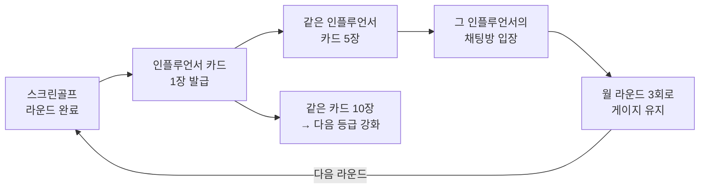
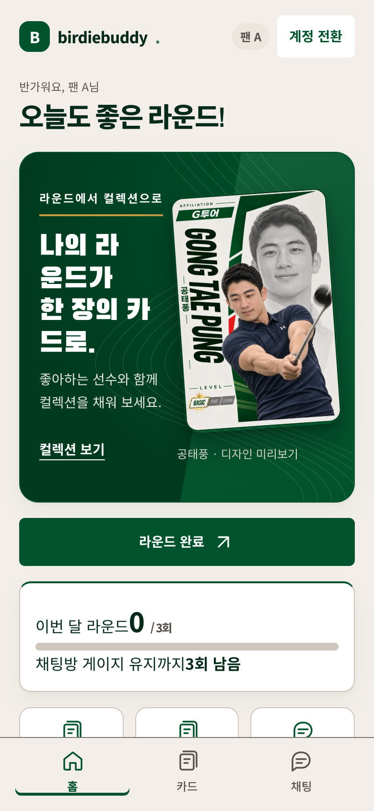
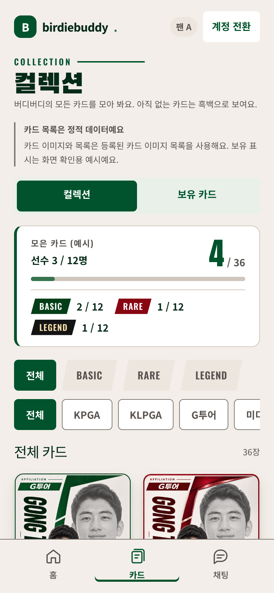
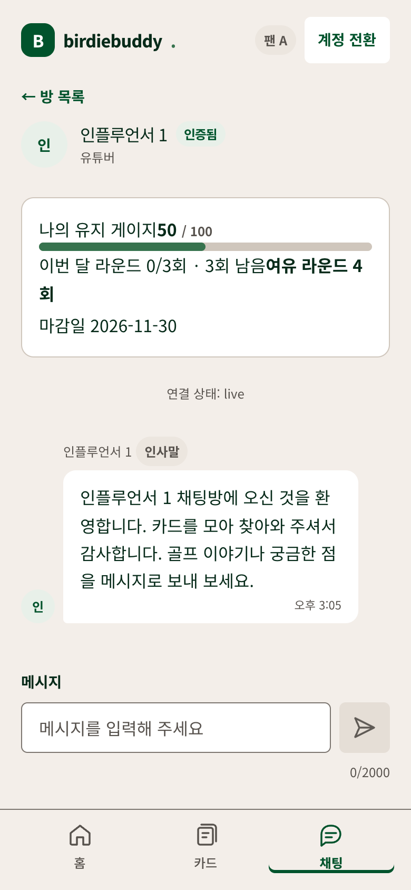
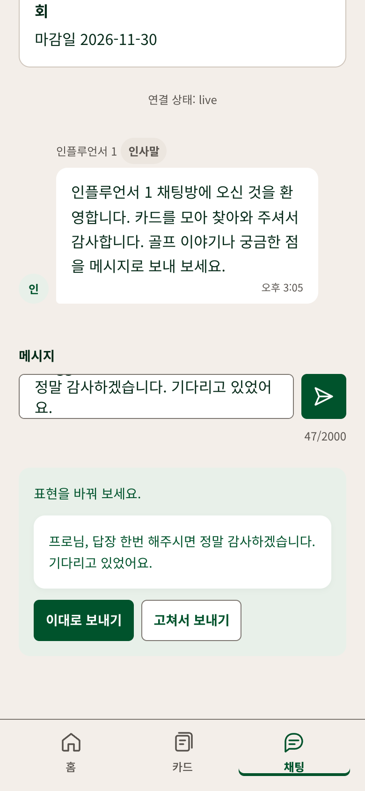
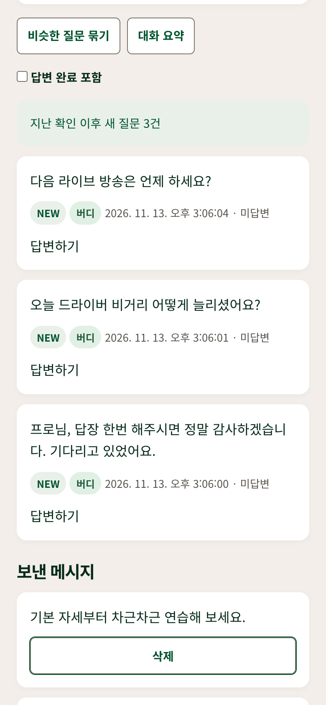

# BirdieBuddy 서비스 소개

> **스크린골프 한 라운드가 좋아하는 골프 인플루언서와 가까워지는 한 걸음이 되는 서비스**
>
> 라운드를 마칠 때마다 AI로 만든 인플루언서 카드를 받고, 카드를 모으면 그 인플루언서와 소통하는 채팅방에 들어갑니다.

2026 사내 AI 개발 해커톤 「골프존 AX CHALLENGE」 출품작 BirdieBuddy(버디버디)의 소개 문서입니다. 제출한 최종 기획서의 1~8번 순서를 그대로 따르고, 각 항목에 확인한 근거·화면·레포 안 실제 파일 링크를 더했습니다. 세부 동작 규칙은 [제품 기획서(prd.md)](./prd.md), 구현 구조는 [architecture.md](./architecture.md)에 있습니다.

## 1. 과제 개요

| 항목 | 내용 |
| --- | --- |
| 참가 분야 | 신규 사업·서비스 |
| 과제명 | BirdieBuddy – 스크린골프 인플루언서 카드 컬렉션과 팬 소통 채팅방 |
| 팀명 | BirdieBuddy (대표: 자성P) |
| 팀 구성 | 자성P – 아키텍처 구성, 프론트엔드 개발 홍주P – 백엔드 개발 현호P – UI 디자인, 효과·연출 개발 문환P – 서비스 기획, AI 기능 개발 |
| 결과물 형태 | 웹 프로토타입 (모바일 390px 화면 기준) |
| 시연 영상 | 2차 제출(11/17) 때 함께 올리고 여기에 링크합니다 |

## 2. 추진 배경 및 문제 정의

**대상 사용자**

- 스크린골프 유저: 골프존 앱의 핵심 이용층인 4050과 새로 들어오는 2030
- 골프 인플루언서: 투어 선수, 미디어 프로

**현황 및 문제점**

- **유저:** 라운드를 마치면 점수 기록 말고는 남는 보상이 없어 다음 라운드로 이어질 이유가 약합니다.
- **인플루언서:** 스크린골프 팬을 직접 만나고 소통할 채널이 부족합니다. 기존 SNS DM은 메시지가 너무 많고 악성 메시지에 그대로 노출됩니다.

**해결 방안**

- 라운드를 1회 마칠 때마다 AI로 만든 인플루언서 카드를 1장 랜덤 발급하고, 같은 카드 10장을 모으면 다음 등급(BASIC → RARE → LEGEND)으로 강화합니다.
- 한 인플루언서의 카드를 누적 5장 모으면 그 인플루언서의 1:N 소통 채팅방에 입장합니다(연예인 소통 플랫폼 '버블' 방식).
- AI가 부적절한 메시지를 보내기 전에 걸러내고, 카드를 많이 모은 팬의 질문을 인플루언서 인박스 위쪽에 올려 줍니다.
- 채팅방 게이지는 매달 라운드 3회를 기준으로 오르내리고, 다 떨어지면 퇴장합니다. 채팅방을 유지하려면 꾸준히 라운드를 하게 됩니다.

**주요 사용 흐름**

- **유저:** 라운드 완료 → 카드 발급 결과 확인 → 컬렉션·강화 → 채팅방 입장 → 메시지 전송(AI 필터 통과 / 수정 제안 / 차단) → 답변 확인
- **인플루언서:** 인박스에서 우선순위 순 질문 확인 → 답변

예를 들어 40대 직장인 팬이 퇴근 후 라운드를 마치고 좋아하는 투어 선수의 카드 5장째를 받으면 채팅방이 열립니다. 드라이버 비거리 질문을 보내고, 며칠 뒤 다음 라운드 대기 중에 내 질문을 인용한 선수의 답장을 확인합니다. 선수는 연습 쉬는 시간에 인박스를 열어, 카드를 많이 모은 팬의 구체적인 질문부터 답합니다.

## 3. 차별성

**기존 방식**

- 스크린골프 라운드 보상은 점수·랭킹 기록이 중심이고, 모으는 재미나 다음 라운드로 이어지는 장치가 약합니다. 지금까지의 라운드 이벤트는 기간을 정해 스탬프·마일리지·경품·상금을 주는 방식이었습니다(예: 명절 18홀 스탬프 → 환급형 마일리지, 대회형 상금 이벤트).
- 팬 소통은 인플루언서 개인 SNS(댓글·DM)에 흩어져 있어 스크린골프 이용과 연결되지 않고, 악성 메시지를 인플루언서가 직접 감당합니다.

**차별화 요소**

- 라운드 → 카드 → 채팅방 입장 → 월 라운드 게이지로 이어지는 구조라, **소통하고 싶은 동기가 곧 라운드 재방문 동기**가 됩니다.
- AI 안전 필터가 보내기 전에 검사해 협박·성희롱·불법 광고 등은 항상 차단하고, 욕설 같은 선택 항목은 표현 수정을 제안합니다.
- 카드 보유량과 질문 품질을 합친 우선순위 점수로 인박스를 정렬해, 인플루언서는 답할 만한 질문부터 보고 열심히 모은 팬은 답변 받을 확률이 높아집니다.

| 비교 대상 | 그 방식 | BirdieBuddy가 다른 점 |
| --- | --- | --- |
| 기존 라운드 이벤트 | 기간 한정, 마일리지·경품 같은 금전형 보상, 끝나면 남는 것이 없음 | 상시 운영, 모을수록 쌓이는 수집형 보상, 실제 인물과의 소통이라는 비금전 보상 |
| 버블(연예인 소통) | 월 구독료를 내고 1:N 메시지 | 돈 대신 **스크린골프 라운드**로 입장권을 얻음. 소통이 라운드 증가로 이어짐 |
| 카드 수집 게임 | 앱 안에서 팩을 열어 수집 | 카드가 **실제 운동 활동(라운드)의 보상**이고, 수집이 실제 인물과의 소통으로 이어짐 |
| SNS 댓글·DM | 메시지가 섞여 답할 것을 고르기 어렵고 악성 메시지에 노출 | AI가 보내기 전에 거르고, **답할 만한 질문을 골라 묶어 줌** |

## 4. 핵심 기능 및 구현 범위

**핵심 기능:** 라운드 완료 시 카드 발급 → 카드 수집·강화 → 채팅방 입장과 AI 안전 필터가 적용된 팬 소통

아래 표의 "확인된 근거"는 2026-11-13 기준 레포에서 확인한 사실입니다. "달성 여부"는 11/17 2차 제출 때 팀이 기입한 값을 같게 옮깁니다.

| # | 구현 목표 | 신청 때 상태 | 확인된 근거 (2026-11-13) | 달성 여부 |
| --- | --- | --- | --- | --- |
| 1 | 데모 계정으로 라운드 완료 시 서버에서 카드 1장을 추첨·발급하고 결과 화면(카드·등급·신규/중복) 표시 | 새로 만듦 | 서버 추첨·발급 함수와 라운드 처리 구현, DB 시험 113건 통과, 1,000회 추첨 분포 확인. 홈·발급 결과 화면 연결. 결과 화면의 등급 표시는 새 3등급 전환 전 | 2차 제출 후 기입 |
| 2 | 컬렉션(전체 수집 현황)과 보유 카드 화면에서 인물·유형·등급 필터와 정렬 제공 | 새로 만듦 | 새 3등급 기준 화면과 필터·정렬 구현. 수집 현황 데이터는 정적 목록(목업), 실제 보유 데이터 연결 전 | 2차 제출 후 기입 |
| 3 | 같은 카드 10장을 다음 등급 1장으로 바꾸는 별도 강화 화면과 연출 | 새로 만듦 | 강화 확인·결과 미리보기 화면(목업). 서버 강화 기능은 기존 계약으로 있고 화면 연결 전 | 2차 제출 후 기입 |
| 4 | 인플루언서별 카드 누적 5장 이상이면 채팅방에 입장하고 메시지를 주고받음 | 새로 만듦 | 입장 조건·채팅 저장·실시간 구독 구현. 로컬 환경에서 입장·전송 확인 | 2차 제출 후 기입 |
| 5 | 메시지 전송 시 AI가 검사해 통과 / 표현 수정 제안 / 차단의 3가지로 처리하고 사유 안내 | 새로 만듦 | 로컬 환경에서 실제 AI 호출로 시연 문장 7개 모두 기대대로 판정. 운영 서버 실호출은 확인 예정 | 2차 제출 후 기입 |
| 6 | 인플루언서 인박스에서 보유량·품질 점수 기준 우선순위로 질문을 정렬하고 답변 | 새로 만듦 | 보유 점수 × 0.6 + 품질 점수 × 0.4 정렬과 답변 구현, 로컬 환경에서 확인 | 2차 제출 후 기입 |
| 7 | 채팅방 게이지: 관리자 화면의 "월 경과" 버튼으로 게이지 감소·퇴장, 라운드 3회로 재입장 시연 | 새로 만듦 | 관리자 데모 월 화면이 서버 데모 월에 연결됨. 퇴장부터 재입장까지 이어서 확인한 기록은 아직 없음 | 2차 제출 후 기입 |
| 8 | 비슷한 질문을 대표 질문 하나로 묶고, 긴 대화를 AI로 요약 | 새로 만듦 | 로컬 환경에서 실제 AI 호출로 묶기 2.4초, 요약 3.7초. 운영 서버 실호출은 확인 예정 | 2차 제출 후 기입 |
| 9 | 별도 가입 없이 데모 계정 전환(유저·인플루언서·관리자)으로 바로 사용 | 새로 만듦 | 목 모드는 더미 계정 버튼으로 바로 전환. 실제 모드는 데모 계정 암호 입력 필요 | 2차 제출 후 기입 |

**시연 화면**

아래 화면은 목 모드(가짜 데이터)로 띄워 모바일 390px로 찍었습니다.

| 홈 | 컬렉션 | 채팅방 |
| --- | --- | --- |
|  |  |  |
| 이번 달 라운드와 게이지 유지까지 남은 횟수 | BASIC·RARE·LEGEND, 유형별 필터와 수집 현황 | 유지 게이지와 첫 입장 인사말 |

| AI 수정 제안 | 인플루언서 인박스 |
| --- | --- |
|  |  |
| 거친 표현을 다듬은 문장으로 제안. 제안 문장은 로컬 실제 AI 호출 결과를 목 화면에 넣어 재현 | 지난 확인 이후 새 질문, 보유 배지(버디), 비슷한 질문 묶기·대화 요약 |

**제외 범위**

- 골프존 앱·회원 로그인·실제 라운드 데이터 연동(웹 버튼으로 대신)
- 실제 신분증 확인·2단계 인증(관리자 승인 화면과 인증 배지 표시만 시연)
- 위반 누적 제재, 재검토 요청, 인플루언서 활동 랭킹, 천장(보장) 시스템, 카드 교환
- 확률형 아이템·초상권 관련 법무 검토(사업화 단계에서 진행)

## 5. 기대 효과

**대상 고객 및 이용 상황**

- **스크린골프 유저:** 라운드를 마치고 앱을 열었을 때 카드를 받고, 좋아하는 인플루언서의 카드를 모아 채팅방에서 질문합니다. 채팅방을 유지하려고 매달 라운드를 이어갑니다.
- **골프 인플루언서:** 스크린골프 팬과 직접 소통하고, 채팅방 전체 메시지로 레슨·이벤트·광고를 알립니다.

**누구에게 어떤 가치가 있나**

| 대상 | 가치 |
| --- | --- |
| 스크린골프 유저 | 라운드마다 남는 보상, 좋아하는 선수와의 직접 소통, 모은 만큼 우대받는 경험 |
| 골프 인플루언서 | 스크린골프 팬과 만나는 채널, 악성 메시지 차단, 답할 질문을 고르고 묶어 주는 인박스 |
| 골프존 | 매달 라운드를 이어갈 이유(재방문), 인플루언서 제휴·광고라는 새 수익원, 카드와 입장 자격이 앱에 쌓이는 락인 |
| 스크린골프 매장 | 라운드가 늘면 매장 매출도 함께 늘고, 매장 단위 이벤트로 이어갈 수 있음 |

**확인한 개선 폭 (AI 기능 실측)**

서비스 효과(라운드 증가)는 아직 잴 수 없어, 실제로 잰 AI 기능의 효과를 먼저 적습니다. 모두 레포 로컬 환경에서 실제 AI를 호출해 시험 세트로 잰 값입니다. 측정 기록은 [문환P 검증 기록](./문환P_verification-log.md)에 있습니다.

| 기능 | 측정 결과 | 측정 방법 |
| --- | --- | --- |
| 비슷한 질문 묶기 | 질문 100건 → 13묶음. 답할 대상 약 87% 감소, 7.2초 | 이어 붙인 100건(19,640자) 상한 입력, 2026-11-12 |
| 대화 요약 | 대화 100건(19,640자) → 약 800~1,000자. 분량 약 95% 축소, 4~6초 | 같은 상한 입력 3회, 2026-11-12 |
| 메시지 안전 판정 | 300문장 시험 세트 기대 판정 일치율 94.0%, 수정 문장 재검사 통과 96.6%, 시연 문장 7/7, 검증 세트 73/73 | 기대 판정을 붙인 문장 세트 실행, 2026-11-11~12 |
| 남은 과제 | 기호·자모로 숨긴 우회 광고의 검증 세트 차단 10/13(목표 11/13 미달) | 우회 광고 문장 세트 실행, 2026-11-12 |

**근거 있는 적용 범위**

- 골프존 회원 약 530만 명, 국내 골프존 시스템 약 43,930대(2025년 2분기)가 적용 대상의 크기입니다.
- 예시 계산: 회원의 1%(약 5.3만 명)가 참여하고 참여자가 한 달에 라운드를 1회 더 하면, 월 약 5.3만 라운드, 연 약 64만 라운드가 늘어납니다. 실측값이 아닌 규모 가늠용 계산입니다.

**사업적 가치**

- **재방문:** 채팅방 게이지가 "월 3회 라운드"를 기준으로 움직여 라운드 빈도 유지·증가를 유도합니다(유저 월평균 라운드 3.4회 가정, 효과 수치는 사업화 단계에서 검증).
- **제휴·광고:** 인플루언서 제휴와 채팅방 광고로 새로운 수익원을 만듭니다.
- **락인:** 모은 카드와 채팅방 입장 자격이 골프존 앱 안에 쌓여 이탈을 줄입니다.
- **라운드 증가 검증 방법:** 시범 운영 3개월 동안 참여자와 비참여자의 월 라운드 수 변화를 비교해 효과가 있는지 판단합니다.

## 6. 활용 및 확산 계획

**사업화 계획**

1. 해커톤 결과물(웹 프로토타입)로 유저·인플루언서 흐름 검증
2. 골프존 앱의 라운드 완료 이벤트와 회원 계정에 연동해 앱 부가 서비스로 시범 운영
3. 공개 지표(팬덤 규모, 스크린골프 연관성, 소통 의지 등 7개 기준)로 인플루언서 후보를 추리고 골프존 앱 데이터로 검증한 뒤 섭외·인증
4. 출시 전 확률 공개·확률형 아이템 해당 여부, 초상권·퍼블리시티권 법무 검토

**사업화 구상 (제출 후 구체화한 제안)**

- **원칙 — 카드는 팔지 않는다:** 카드는 라운드 보상으로만 받습니다. 확률형 아이템 유료 판매는 2024년 3월부터 확률 공개 의무가 강화된 규제 영역이고, 유료 판매가 섞이면 "운동한 만큼 받는 보상"이라는 신뢰가 무너집니다.

| 수익원 | 내용 | 누가 돈을 내나 | 단계 |
| --- | --- | --- | --- |
| 라운드 증가 | 게이지와 카드 수집이 라운드 빈도를 높이고, 늘어난 라운드가 기존 라운드 매출로 이어짐 | 유저(기존 라운드 요금) | 1단계 |
| 인플루언서 홍보 채널 | 채팅방 전체 메시지로 레슨·용품·방송·대회를 알리는 홍보 상품. 광고 표시와 발송 횟수 상한을 둠 | 용품·레슨 브랜드, 인플루언서 소속사 | 2단계 |
| 스폰서 카드 | 브랜드·대회와 함께 만드는 시즌 한정 카드, 해당 매장·대회 라운드에서만 발급 | 골프 브랜드, 대회 주최사, 매장 | 2단계 |
| 팬 이벤트 | 카드를 많이 모은 팬 대상 레슨 매칭, 사인회, 동반 라운드 응모 | 참가 팬, 인플루언서와 수익 배분 | 3단계 |
| 팬덤 데이터 | 인플루언서별 보유자·채팅 활동 데이터를 G투어 마케팅·섭외·스폰서 영업에 활용(개인 식별 정보 제외) | 골프존 내부 활용 | 2단계부터 |

| 단계 | 목표 | 하는 일 | 확인할 지표 |
| --- | --- | --- | --- |
| 1단계 시범 | 라운드 증가 증명 | 일부 매장·회원 대상 무료 운영, 인플루언서 10명 안팎 섭외 | 참여자와 비참여자의 월 라운드 수 차이, 월 3회 이상 유지율 |
| 2단계 확대 | 채널 수익화 | 홍보 상품·스폰서 카드 출시, 인플루언서 확대 | 채팅방 입장자 수, 홍보 메시지 반응, 스폰서 계약 수 |
| 3단계 확장 | 팬 경제 | 팬 이벤트, 해외 골프존 서비스 적용 검토 | 이벤트 참여율, 인플루언서 답변 도달률 |

| 비용·리스크 | 대응 |
| --- | --- |
| 인플루언서 섭외·활동 유지 | 수익 배분, 월 활동 일수 기준과 휴면 정책 |
| AI 호출 비용 | 제안 문장을 그대로 보내면 재검사 생략, 방별 AI 호출 제한 |
| 규제(확률형 아이템, 광고 표시) | 카드 유료 판매 없음, 확률 공개, 출시 전 법무 검토 |
| 초상권 | 실존 인물 카드는 동의·계약 후 제작, 인증 취소 시 발행 중단 |
| 인플루언서 답장 저조 | 활동 지표 기반 휴면 표시, 휴면 방은 팬 게이지를 정산하지 않아 팬 보호 |

**다른 서비스·업무로의 확산**

- **AI 모듈 재사용:** 안전 판정·질문 묶기·대화 요약은 서비스와 분리된 모듈로 만들었습니다. 사용자 메시지가 오가는 골프존 앱의 다른 공간(커뮤니티, 라이브 채팅, 고객 문의 분류 등)에도 붙일 수 있습니다.
- **개발 방식 확산:** 7번의 문서 기반 에이전트 협업 방식을 사내 다른 개발 프로젝트에 적용할 수 있습니다.

**필요 지원 사항:** 사내 데이터 연동, 개발 지원, 보안 검토, 기존 서비스 연동

- 라운드 완료 이벤트(중복 발급을 막는 라운드 ID 포함)와 골프존 회원 인증 연동
- 채팅 메시지·차단 원문 보관 기간 등 개인정보 처리 보안 검토
- 골프존 앱 내 진입점과 알림 연동, 인플루언서 섭외·계약 관련 협의

## 7. 데이터 및 AI 활용

**활용 데이터:** 가상 데이터. 데모 유저·인플루언서 계정, 라운드·카드 발급 기록, 채팅 메시지는 모두 시연용으로 만들었고, 카드 이미지는 생성형 이미지 AI로 제작했습니다.

### 7.1 서비스 기능의 AI

| AI 기능 | 모델 | 하는 일 |
| --- | --- | --- |
| 메시지 안전 판정 | Typesafe AI 판정 모델 | 전송 전에 10개 항목 점수로 판정. 선택 항목(욕설, 비하, 외모 평가)은 수정 제안, 항상 차단 항목(협박, 스토킹, 성희롱, 사생활 침해, 혐오, 불법 광고, 도배)은 차단하고 사유 안내. 기호·자모·닮은 글자로 숨긴 불법 도박 광고는 글자를 정규화해 한 번 더 검사. 인플루언서의 답변·전체 메시지에도 항상 차단 항목 적용 |
| 표현 수정 제안 | Claude Haiku | 뜻은 살리고 표현만 순화한 문장을 제안. 제안 문장도 판정 모델로 다시 검사해 모든 항목을 통과한 것만 보여 줌 |
| 인박스 우선순위 | 판정 모델의 품질 점수 | 품질 점수(질문이 구체적이고 답할 만한지)와 카드 보유 점수를 4:6으로 합쳐 정렬 |
| 유사 질문 묶기 | Claude Haiku | 비슷한 미답변 질문을 묶고 인원수와 대표 질문 표시. 대표 질문은 개인 정보를 뺀 200자 이내 문장으로 새로 쓰고 다시 검사 |
| 대화 요약 | Claude Haiku | 긴 채팅방 대화를 인플루언서가 빠르게 훑어볼 수 있게 요약 |
| AI 장애 대비 | 금칙어 검사 | AI 응답이 늦거나(전송 판정 8초 제한) 실패하면 금칙어 검사로 대신해 채팅을 계속 쓸 수 있게 함 |
| 카드 이미지 | Z-Image Turbo(로컬) | 가상 인플루언서 12명의 인물 사진만 AI로 생성하고, 프레임·이름·등급 표시는 코드로 그려 3등급 36장 제작. 이름 철자가 틀리지 않고 세 등급에서 인물이 똑같이 유지됨 |

AI 기능 코드는 [`supabase/functions/_shared/ai/`](../supabase/functions/_shared/ai/), 시험 세트와 회귀 스크립트는 [`lib/ai/tests/`](../lib/ai/tests/), 카드 이미지 제작 기록은 [card-image-prompt-guide.md](./card-image-prompt-guide.md)에 있습니다.

### 7.2 만든 과정: 문서 기반 에이전트 협업

4명이 각자 AI 코딩 에이전트(Claude Code, Codex)와 개발하면서, 회의·메신저 대신 레포 안의 md 문서로 에이전트끼리 소통하게 했습니다. 아래 파일을 순서대로 보면 실제로 어떻게 일했는지 따라갈 수 있습니다.

| 단계 | 하는 일 | 실제 파일 |
| --- | --- | --- |
| 공통 기준 | 제품 규칙, 구조, 용어를 한곳에 둠 | [prd.md](./prd.md) · [architecture.md](./architecture.md) · [GLOSSARY.md](../GLOSSARY.md) · [디자인 시스템 에이전트 가이드](../design-system/AGENT_GUIDE.md) |
| 담당자별 실행 명세 | 각 에이전트가 작업 전에 읽고 자기 담당 범위만 구현 | [자성P](./자성P_plan.md) · [홍주P](./홍주P_plan.md) · [현호P](./현호P_plan.md) · [문환P](./문환P_plan.md) · [시연·발표](./anonymous-plan.md) |
| 요청과 기본값 | 다른 담당자에게 필요한 일은 요청 표에 적고, 답이 오기 전에는 적어 둔 기본값으로 진행해 멈추지 않음 | [문환P 계획 1절 요청 표](./문환P_plan.md#1-동료와-동료-에이전트-전달-사항) |
| 버전을 매긴 계약 | 백엔드 호출 방법을 판번호로 관리(현재 1.8판) | [홍주P 계획 6~8절](./홍주P_plan.md#6-api조회오류-공통-계약) |
| 기준 변경 인계 | 기준이 바뀌면 인계 문서를 만들어 모든 에이전트가 같은 기준으로 맞춤 | [카드 기준 변경](./card-spec.md) · [카드 UI 인계](./card-ui-handoff.md) · [카드 에셋 인계](./card-assets.md) |
| 변경 공유 | 다른 담당자가 알아야 할 변경은 커밋 메시지와 PR 본문에 담당자별로 적음 | [PR #40 예시](https://github.com/moonankim/BirdieBuddy/pull/40) · [PR #41 예시](https://github.com/moonankim/BirdieBuddy/pull/41) |
| 검증 기록 | 실행한 검증과 미확인 항목을 분리해 기록 | [문환P 검증 기록](./문환P_verification-log.md) |

- **규모:** 2026-11-09부터 2026-11-13까지 main 기준 커밋 167건, 병합 PR 38건(2026-11-13 기준).
- **자동 시험:** 화면 단위·인수 시험, 백엔드 시험(DB 함수·권한·실시간 구독), E2E 스모크 시험을 갖췄습니다. 홍주P 검증 기록 기준으로 Node 27건, Deno 150건, DB 197건, UI 236건이 통과했습니다. 시험 코드는 [`tests/`](../tests/)와 [`supabase/tests/`](../supabase/tests/)에 있습니다.
- **AI 품질 조정:** AI 판정은 시연 문장 세트로 반복 실행해 프롬프트와 기준값을 조정했습니다. 카드 이미지는 다른 AI 모델에게 독립 검수를 맡겨 자세·신체 오류를 걸러 냈습니다.
- **진행 예정:** PRD의 제품 규칙과 예외 상황을 테스트 스펙 문서로 정리하고, 에이전트가 이를 E2E 시험으로 옮겨 시연 흐름 전체를 자동으로 검증합니다(카드 발급, 강화, 채팅방 입장 조건, AI 판정 3분기, 게이지 퇴장·재입장).

### 7.3 신뢰와 안전

- **팬 보호:** 팬끼리는 서로의 메시지를 보지 못합니다. 다른 팬에게 보이는 질문 인용은 닉네임 없이, 모든 필터를 통과한 문장만 씁니다.
- **인플루언서 보호:** 항상 차단 항목은 인플루언서 설정과 관계없이 막고, 욕설·비하·외모 평가만 인플루언서가 끌 수 있습니다.
- **사칭 방지:** 인증된 인플루언서만 카드를 발행하고 채팅방을 엽니다(해커톤에서는 관리자 승인 화면과 인증 배지로 시연).
- **초상권:** 카드 인물은 모두 AI로 만든 가상 인물입니다. 실존 인물 카드는 사업화 단계에서 동의와 계약을 거쳐 만듭니다.

## 8. 확인

- 회사 데이터, 고객 정보, 회사 코드를 쓰지 않고 가상 데이터나 공개 데이터만 사용했습니다.
- 회사 자료를 외부 AI 도구에 올리지 않았습니다.
- 실제 매장 기기나 회사 시스템에는 연결하지 않았습니다.

## 참고 자료

- 골프존 회원 수: [한국경제 — 골프존, 2025년형 지역별 인기 코스·정보 데이터 공개](https://www.hankyung.com/article/2025031807061)
- 골프존 시스템 대수: [증권사 리서치 리포트(2025-12-03)](https://stock.pstatic.net/stock-research/company/74/20251203_company_708973000.pdf)
- 기존 라운드 이벤트 예: [파이낸셜뉴스 — 추석 18홀 스탬프·환급형 마일리지](https://www.fnnews.com/news/202109010840522799) · [헤럴드K — 팔도페스티벌 시즌2](https://www.heraldk.com/article/2025111716403043029)
- 확률형 아이템 공개 의무: [ZDNet Korea — 확률형 아이템 공개 의무화](https://zdnet.co.kr/view/?no=20240222164405)
- 서비스 벤치마크(버블, 위버스 DM, 카카오톡 채널, SOOP, YouTube·Twitch 배지 등): [prd.md](./prd.md)와 [문환P_plan.md](./문환P_plan.md) 3절
