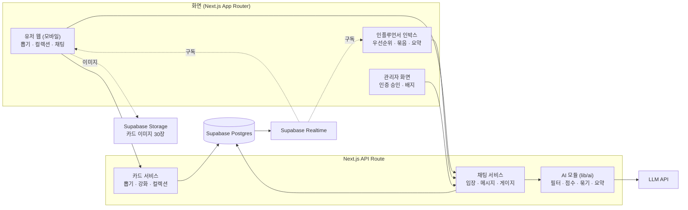

# BirdieBuddy — 자성P 작업 계획

**역할:** 프론트엔드 — 채팅 서비스 화면 중심

> 기준 문서: [BirdieBuddy 해커톤 개발 설계 & 역할 분담](https://claude.ai/artifact/HQ7wLf6Cewh2thGTH37Dof) · 작성일 2026-11-09
> 기획안: spec_BirdieBuddy.md (스크린골프 인플루언서 카드 컬렉션)

## 1. 전체 시스템 아키텍처

화면 3종이 하나의 Next.js 앱을 거쳐 Supabase(DB·실시간·스토리지)와 LLM API에 닿는 구조입니다.
실제 골프존 라운드·회원 연동은 하지 않고 **'라운드 완료' 버튼 + 데모 계정 전환**으로 대체합니다.



### 기술 스택 (확정)

| 영역 | 선택 | 비고 |
| --- | --- | --- |
| 프론트·API | Next.js (App Router) + TypeScript + Tailwind | 화면과 API를 한 레포에서 |
| DB | Supabase Postgres | 스키마: `supabase/schema.sql` (홍주P B-01) |
| 실시간 채팅 | Supabase Realtime (`messages` 테이블 구독) | 막히면 3초 폴링으로 대체 |
| 이미지 | Supabase Storage | 카드 이미지 30장 사전 생성 |
| AI | LLM API (메시지당 1회 호출) | 필터 + 품질 점수를 JSON 하나로 |
| 배포 | Vercel | 1일차 오전 첫 배포 |
| 보안 | RLS 끔, API Route에서만 service role 키 사용 | 클라이언트는 Realtime 구독용 anon 키만 |

### 레포 구조와 담당 경계

```
BirdieBuddy/
├─ app/
│  ├─ (user)/draw/            # 카드 뽑기 연출·결과        — 현호P
│  ├─ (user)/collection/      # 컬렉션·강화                — 현호P
│  ├─ (user)/chat/            # 채팅방 목록·입장·대화       — 자성P
│  ├─ inbox/                  # 인플루언서 인박스          — 자성P
│  ├─ admin/                  # 관리자 인증 승인            — 자성P
│  └─ api/                    # 모든 API Route              — 홍주P
│     ├─ rounds/  cards/  me/  rooms/  verifications/  admin/  demo/
├─ components/
│  ├─ card/                   # 카드·카드팩·등급 효과       — 현호P
│  ├─ chat/                   # 메시지·게이지·배지          — 자성P
│  └─ ui/                     # 공통 UI (디자인 토큰)       — 자성P 셋업, 현호P 디자인
├─ lib/
│  ├─ ai/                     # moderateAndScore 등         — 문환P
│  ├─ db/                     # Supabase 클라이언트·쿼리    — 홍주P
│  ├─ scoring.ts              # ownScore·priority 공식      — 홍주P
│  └─ config.ts               # game_config 읽기            — 홍주P
└─ supabase/
   ├─ schema.sql              # 테이블 12개 + upgrade_card  — 홍주P
   └─ seed.sql                # 데모 계정·인플루언서·템플릿 — 홍주P
```

### 개발 규칙 (전원)

1. **상태가 있는 화면은 클라이언트 컴포넌트로** — 뽑기 연출, 채팅, 인박스, 게이지처럼 상태·이벤트가 있는 컴포넌트는 파일 맨 위에 `'use client'`를 붙입니다. 서버 컴포넌트는 레이아웃·정적 껍데기에만 씁니다.
2. **데이터는 항상 `/api/*`를 거쳐서** — 화면에서 Supabase 쿼리를 직접 호출하지 않습니다. Supabase를 클라이언트에서 직접 쓰는 건 `messages` **실시간 구독뿐**입니다. API 명세(T-01)가 화면과 서버 사이의 유일한 기준입니다.

### 데이터 모델 (테이블 12개)

| 테이블 | 주요 컬럼 | 용도 |
| --- | --- | --- |
| users | id, nickname, role(user/influencer/admin) | 데모 계정 3종 |
| influencers | id, user_id, name, type(youtuber/media_pro/tour), verified_at | 후보 10명, 배지 = verified_at + type |
| card_templates | id, influencer_id, style(illust/retro/holo), image_url | 인물 × 스타일 = 30행 |
| user_cards | user_id, template_id, grade, count | 등급별 보유 장수, 강화 시 grade 한 칸 이동 |
| rounds | id, user_id, played_at | 라운드 완료 기록 (게이지 계산에도 사용) |
| draws | id, user_id, round_id, template_id, grade, is_new | 뽑기 결과 이력 |
| chat_rooms | id, influencer_id, filter_options(jsonb) | 인플루언서당 1개 |
| room_members | room_id, user_id, gauge, status(active/left) | 입장 상태와 게이지 |
| messages | id, room_id, sender_id, sender_type, reply_to, body, filter_verdict, own_score, quality_score, priority, cluster_id | 유저 메시지 + 인플루언서 답변, 차단 건도 저장 |
| message_clusters | id, room_id, representative, member_count | 유사 질문 묶음 |
| verifications | id, influencer_id, type, evidence_url, status, reviewed_by | 인증 신청과 심사 |
| game_config | key, value(jsonb) | 확률·기준값 (코드에 하드코딩 금지) |

등급: `common`(일반) → `rare`(레어) → `epic`(에픽) → `special`(스페셜)

### 설정값 (game_config, 잠정 확정 · 배포 없이 값만 변경)

| key | 값 |
| --- | --- |
| grade_rates | 일반 70 · 레어 22 · 에픽 7 · 스페셜 1 (%) |
| upgrade_cost | 같은 템플릿·등급 10장 → 다음 등급 1장 |
| room_entry | 해당 인플루언서 카드 5장 (등급 무관) |
| priority_weights | 보유 0.6 : 품질 0.4 |
| gauge | 시작 100, 월 3회 미만이면 달마다 -50, 0이면 퇴장 |

### API 목록

| 메서드 · 경로 | 하는 일 | 티어 | 구현 | 사용 화면 |
| --- | --- | --- | --- | --- |
| POST /api/rounds/complete | 라운드 기록 + 카드 1장 추첨, 결과 반환 | P0 | 홍주P B-03 | 현호P |
| GET /api/me/collection | 인물별·등급별 보유 현황 | P0 | 홍주P B-04 | 현호P |
| POST /api/cards/upgrade | 10장 소모 → 다음 등급 1장 (`upgrade_card` 함수) | P0 | 홍주P B-04 | 현호P |
| GET /api/rooms | 채팅방 목록 + 입장 가능 여부 | P1 | 홍주P B-05 | 자성P |
| POST /api/rooms/:id/join | 입장 조건 확인 후 입장 | P1 | 홍주P B-05 | 자성P |
| GET /api/rooms/:id/messages | 유저용 대화 목록 | P1 | 홍주P B-06 | 자성P |
| POST /api/rooms/:id/messages | 필터 → 점수 → 저장, 차단·수정 제안 반환 | P1 | 홍주P B-06 + 문환P A-02·A-03 | 자성P |
| GET /api/rooms/:id/inbox | 인플루언서용 우선순위 정렬 목록 | P1 | 홍주P B-08 | 자성P |
| POST /api/rooms/:id/reply | 인플루언서 답변 | P1 | 홍주P B-08 | 자성P |
| POST /api/demo/advance-month | 한 달 경과 시뮬레이션 (게이지 감소·퇴장) | P1 | 홍주P B-07 | 자성P |
| POST /api/verifications | 인증 신청 | P2 | 홍주P B-09 | 자성P |
| PATCH /api/admin/verifications/:id | 승인·반려, 배지 부여 | P2 | 홍주P B-09 | 자성P |
| POST /api/rooms/:id/summary | 대화 요약 | P2 | 문환P A-05 | 자성P |
| PATCH /api/rooms/:id/filter | 선택 필터 해제 | P2 | 홍주P B-10 | 자성P |

### AI 모듈 인터페이스 (문환P 제공 → 홍주P 호출)

우선순위 계산(`ownScore`, `priority`)은 AI가 아닌 공식이므로 홍주P가 `lib/scoring.ts`에 둡니다. AI 모듈은 LLM을 호출하는 함수만 제공합니다.

```ts
// lib/ai/index.ts
export type Verdict = 'pass' | 'suggest' | 'block';

export async function moderateAndScore(input: {
  body: string;
  disabledFilters: string[];          // 인플루언서가 끈 선택 필터 (욕설, 비하 등)
}): Promise<{
  verdict: Verdict;
  category?: string;                  // 협박, 성희롱, 스팸 등
  reason?: string;                    // 유저에게 보여줄 짧은 사유
  rewrite?: string;                   // suggest일 때 수정 제안
  quality: number;                    // 0~100, 메시지 품질 점수
}>;

export async function clusterQuestion(roomId: string, body: string): Promise<string | null>; // P2, cluster_id
export async function summarize(messages: { body: string; sender: string }[]): Promise<string>;  // P2
```

### 범위 우선순위와 체크포인트

| 티어 | 범위 | 완료 시점 |
| --- | --- | --- |
| P0 | 라운드 완료 → 카드 뽑기 연출 → 컬렉션 → 10장 강화 | 1일차 저녁 (T-03) |
| P1 | 채팅방 입장 조건, 유저 채팅, AI 안전 필터·안내, 우선순위 인박스, 유지 게이지 | 2일차 점심 (T-04) |
| P2 | 인증 신청·관리자 승인·배지, 유사 질문 묶기, 대화 요약, 필터 해제 | 2일차 오후 동결 전 |

### 공통 티켓 (전원)

- [ ] **T-01** API 명세 합의 — 위 API별 요청·응답 JSON 예시를 킥오프 2시간 안에 고정 (P0)
- [ ] **T-02** 미정 항목 결정 — 인플루언서 10명, 스타일 3종 (등급 확률·입장 기준·뽑기 로직은 확정) (P0)
- [ ] **T-03** P0 통합 체크포인트 — 라운드 완료 → 뽑기 → 컬렉션 → 강화가 배포 URL에서 동작 (P0)
- [ ] **T-04** P1 통합 체크포인트 — 입장 → 전송 → 필터 → 인박스 정렬 (P1)
- [ ] **T-05** 기능 동결 후 시연 리허설 2회 (P0)

### 담당 미정 티켓

| ID | 티켓 | 티어 | 담당 | 비고 |
| --- | --- | --- | --- | --- |
| U-01 | 시연 대본·발표 자료 | P1 | 미정 (anonymous) | 개발 완료 후 담당 결정 |

### 뽑기 로직 (확정)

1. game_config의 grade_rates로 **등급을 먼저** 뽑고, 30장(10명 × 3스타일) 중 하나를 **균등 추첨** (인플루언서별 가중치 없음)
2. **신규(isNew)** = 해당 템플릿(인물 + 스타일)을 등급 무관하게 처음 보유한 경우
3. 시연용 **등급 고정 옵션**: `POST /api/rounds/complete` 요청에 `{"demoForceGrade": "special"}`을 넣으면 그 등급으로 지급 (데모 계정 전용, 시연 대본에서 스페셜 연출 보여줄 때 사용)

## 2. 자성P 담당 범위

채팅방 목록·입장·대화, 유지 게이지, 차단·수정 제안 UI. 추가로 프로젝트 셋업, 인플루언서 인박스, 관리자 승인 화면을 맡습니다.

**작업 경로:** `app/(user)/chat/`, `app/inbox/`, `app/admin/`, `components/chat/`, `components/ui/` (셋업)

**받는 것 (의존)**

- 홍주P: 채팅·입장·게이지·인박스·인증 API (B-05~B-10)
- 문환P: 필터 응답 형식(verdict/reason/rewrite) — A-02
- 현호P: 채팅·인박스·관리자 화면 디자인(D-01), 배지 3종(D-09)

**주는 것**

- Next.js 프로젝트 골격·공통 레이아웃 (F-01) → 현호P가 그 위에서 작업
- 데모 계정 전환 토글 (F-02) → 전원 시연에 사용

## 3. 자성P 티켓

| ID | 티켓 | 티어 | 선행 | 완료 기준 |
| --- | --- | --- | --- | --- |
| F-01 | Next.js(App Router, TS, Tailwind) 프로젝트 셋업, Supabase 클라이언트, 공통 레이아웃·라우팅 | P0 | - | 레포 공유, Vercel 프리뷰에서 빈 화면 4개(/draw /collection /chat /inbox) 이동 가능 |
| F-02 | 데모 계정 전환 토글 (유저·인플루언서·관리자) | P0 | B-02 | 헤더에서 계정을 바꾸면 화면과 API 요청의 사용자 ID가 바뀜 |
| F-03 | 채팅방 목록 + 입장 가능 여부·부족한 카드 장수 표시 | P1 | B-05 | 입장 불가 방에 "카드 N장 더 필요" 표시 |
| F-04 | 채팅방 입장 화면 + AI 필터 안내 문구 | P1 | F-03 | 입장 시 "AI가 부적절한 메시지를 자동으로 걸러냅니다" 노출 |
| F-05 | 대화 화면 (메시지 목록, 전송, 실시간 구독, 보유량 배지) | P1 | B-06 | 두 브라우저에서 보낸 메시지가 새로고침 없이 보임 |
| F-06 | 전송 시 차단 사유 안내·표현 수정 제안 UI | P1 | A-02 | block이면 사유 표시, suggest면 수정안을 한 번에 적용해 재전송 |
| F-07 | 유지 게이지 상단 바, "이번 달 N회 남음" 안내, 소진 시 퇴장·재입장 | P1 | B-07 | advance-month 호출 후 게이지 감소, 0이면 퇴장 화면 |
| F-08 | 인플루언서 인박스 (우선순위 정렬, 배지, 답변, "오늘 N건 걸러냄") | P1 | B-08 | 보유량 많은 유저 메시지가 위에 뜨고, 답변이 유저 화면에 표시 |
| F-09 | 인박스 유사 질문 묶음(N명 질문)·대화 요약 버튼 | P2 | A-04, A-05 | 묶음 카드에 인원수 표시, 요약 버튼으로 요약문 표시 |
| F-10 | 관리자 인증 승인 화면 + 채팅방·카드에 배지 표시 | P2 | B-09, D-09 | 승인 시 해당 인플루언서 채팅방에 유형별 배지 표시 |
| F-11 | 인플루언서 필터 해제 설정 + "이 방은 필터가 꺼져 있어요" 안내 | P2 | B-10 | 해제 확인 동의 후 유저 입장·전송 화면에 안내 노출 |

### 체크리스트

- [ ] **F-01** Next.js(App Router, TS, Tailwind) 프로젝트 셋업, Supabase 클라이언트, 공통 레이아웃·라우팅 (P0)
- [ ] **F-02** 데모 계정 전환 토글 (유저·인플루언서·관리자) (P0)
- [ ] **F-03** 채팅방 목록 + 입장 가능 여부·부족한 카드 장수 표시 (P1)
- [ ] **F-04** 채팅방 입장 화면 + AI 필터 안내 문구 (P1)
- [ ] **F-05** 대화 화면 (메시지 목록, 전송, 실시간 구독, 보유량 배지) (P1)
- [ ] **F-06** 전송 시 차단 사유 안내·표현 수정 제안 UI (P1)
- [ ] **F-07** 유지 게이지 상단 바, "이번 달 N회 남음" 안내, 소진 시 퇴장·재입장 (P1)
- [ ] **F-08** 인플루언서 인박스 (우선순위 정렬, 배지, 답변, "오늘 N건 걸러냄") (P1)
- [ ] **F-09** 인박스 유사 질문 묶음(N명 질문)·대화 요약 버튼 (P2)
- [ ] **F-10** 관리자 인증 승인 화면 + 채팅방·카드에 배지 표시 (P2)
- [ ] **F-11** 인플루언서 필터 해제 설정 + "이 방은 필터가 꺼져 있어요" 안내 (P2)

## 4. 자성P 타임라인

| 구간 | 할 일 |
| --- | --- |
| 사전 준비 | F-01 |
| 1일차 오전 | T-01·T-02 킥오프 후 F-02 |
| 1일차 오후 | F-03, F-04, F-05 (목 데이터로 먼저) |
| 1일차 저녁 | T-03 P0 통합 (전원) |
| 1일차 밤 | F-06, F-07, F-08 |
| 2일차 오전 | F-09, F-10 |
| 2일차 점심 | T-04 P1 통합 (전원) |
| 2일차 오후 | F-11 여유분 → 기능 동결 → T-05 리허설 |
